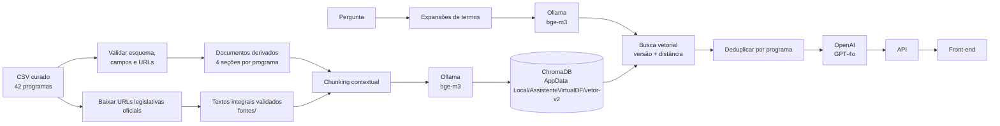

# RAG do Assistente do DF

Este diretório contém a implementação única do RAG: leitura e validação da base, preparação de documentos, busca vetorial, geração de respostas e comandos de ingestão e avaliação. A API importa os módulos daqui. O protótipo antigo de `Dados/rag-ragas/` foi mantido como histórico; os testes e a avaliação executados pela aplicação agora ficam aqui.

## Arquitetura atual

1. **Fonte de conhecimento:** `../programas_sociais_legislacao_links_oficiais.csv`, com 42 programas federais e 22 colunas, fornece os dados estruturados. Os arquivos Markdown em `base/` são documentos derivados dos registros, não fontes independentes. O coletor `baixar_fontes.py` baixa textos legislativos integrais de URLs oficiais distintas e grava as fontes em `fontes/`; nesta coleta, 27 páginas HTML foram validadas e indexadas.
2. **Tratamento e chunking:** o pipeline valida esquema, campos essenciais e URLs oficiais; transforma cada programa em quatro seções semânticas e cria 168 trechos estruturados. Também divide os textos legislativos baixados em trechos de até 1.200 caracteres, com sobreposição de 180 caracteres e ajuste por espaço. Cada trecho é contextualizado com o programa e a fonte.
3. **Embeddings:** Ollama executa `bge-m3` para converter os trechos e as perguntas (após expansão de alguns termos) em vetores. A ingestão envia os trechos em lotes de até 32; a busca usa o mesmo modelo de embedding.
4. **Banco vetorial:** ChromaDB persiste esses vetores usando distância cosseno. No Windows, o local padrão é `%LOCALAPPDATA%\AssistenteVirtualDF\vetor-v2`; em outros sistemas, é `Dados/vetor-v2/`. `VECTOR_DB_PATH` permite configurar outro local. O índice é derivado e pode ser recriado a partir do CSV e das fontes baixadas.
5. **Verificação de escopo:** antes de gerar texto, GPT-4o classifica semanticamente a pergunta como dentro ou fora do escopo informativo. A classificação considera a intenção da frase e o histórico recente; não usa uma palavra-chave isolada nem o resultado da busca para justificar uma resposta. Solicitações fora do escopo e operações individuais (consulta/cadastro/aprovação) recebem uma abstenção fixa.
6. **Recuperação e geração:** o RAG expande alguns termos populares, busca trechos, limita distância, filtra a versão atual e deduplica por programa. Se a pergunta for pertinente mas não houver contexto suficiente, informa que não encontrou evidência. GPT-4o redige uma resposta com as fontes recuperadas.
7. **Aplicação:** a API entrega a resposta e as referências ao front-end.

O mapeamento dos requisitos do segundo desafio, o estado das evidências e os passos para a demonstração estão em [`semana_2.md`](../../Documentacao/semana_2.md).



## O que já foi feito no RAG

- Centralização do código de RAG em `Dados/rag/`; não há uma segunda implementação usada pelo back-end.
- Validação do CSV e preservação explícita de critérios e público-alvo ausentes ou parciais.
- Coleta de textos legislativos integrais apenas de domínios oficiais, com validação do conteúdo e aviso explícito para links indisponíveis ou formatos não suportados.
- Divisão por seções semânticas, com o programa e a seção no contexto de cada trecho.
- Persistência de embeddings no ChromaDB no caminho local padrão do sistema.
- Expansão de consultas para alguns termos cotidianos, filtro por versão do conjunto, limite de distância e deduplicação por programa.
- Respostas orientadas a usar somente os trechos encontrados, citar as fontes, explicitar lacunas e não decidir elegibilidade.
- Classificação semântica de escopo e geração com OpenAI GPT-4o; Ollama é usado somente para embeddings.
- Contexto de geração melhorado com nome do programa, órgão responsável e status dos critérios em campos separados; o prompt agora proíbe deduzir o órgão pelo tema, título da fonte ou URL. A temperatura está em zero para reduzir variação, sem garantir ausência total de alucinações.
- Avaliação RAGAS unificada com o RAG da API: a mesma busca, classificador e geração são testados, inclusive com seis casos fora do escopo.
- Testes automatizados de parsing, indexação, recuperação, filtros, abstenção, citações e integração da API.

## O que ainda não foi feito

- **Curadoria da base:** 27 textos legislativos integrais foram coletados de páginas oficiais e indexados. Dois links da Imprensa Nacional são PDFs e ainda não são extraídos; uma página legislativa retornou erro temporário. A coleta atinge o mínimo de 20 documentos, mas as informações de elegibilidade da planilha permanecem parciais e precisam de revisão humana.
- **Cobertura completa do DF:** os 42 registros são programas federais; o catálogo distrital não está completo.
- **Autenticação:** há apenas telas de protótipo em `Front-end/conta.html`. Login, cadastro, recuperação de senha, envio de token e gerenciamento de contas estão desativados; não há API de autenticação, banco de contas nem serviço de e-mail.
- **Garantia de veracidade das respostas:** o modelo pode errar mesmo com recuperação correta. O protótipo precisa de testes de resposta com perguntas reais e revisão humana antes de uso institucional.

## Instalação e execução

Instale as dependências do back-end, configure sua chave da OpenAI e mantenha o Ollama em execução para os embeddings:

```powershell
python -m pip install -r .\Back-end\requirements.txt
$env:OPENAI_API_KEY = "sua-chave"
ollama pull bge-m3
```

Baixe/atualize os textos legislativos e gere os vetores depois de modificar o CSV ou as fontes:

```powershell
python .\Dados\rag\baixar_fontes.py
python .\Dados\rag\ingestao.py
```

Consulte trechos ou avalie a recuperação@5:

```powershell
python .\Dados\rag\buscar.py "Tem ajuda para comprar o botijão de gás?"
python .\Dados\rag\buscar.py --responder "Como faço para não pagar a inscrição do Enem?"
python .\Dados\rag\avaliar.py
```

`avaliar.py` mede se o programa esperado aparece nos primeiros cinco resultados; não mede a precisão factual das respostas geradas. Nesta revisão, o resultado foi **11/11 (100%)** para os casos de teste definidos. No Windows, o banco persistente fica em `%LOCALAPPDATA%\AssistenteVirtualDF\vetor-v2`; a recuperação requer `bge-m3`, e classificação/geração requerem `OPENAI_API_KEY`. Use um caminho sem acentos ao configurar `VECTOR_DB_PATH` no Windows.

## Avaliação automatizada RAG + RAGAS

Instale as dependências extras do avaliador uma vez:

```powershell
python -m pip install -r .\Dados\rag\requirements-avaliacao.txt
```

Com `OPENAI_API_KEY` configurada, Ollama ativo para embeddings e índice já ingerido, execute uma amostra curta e depois a bateria completa:

```powershell
python .\Dados\rag\avaliar_ragas.py todos --limite 2
python .\Dados\rag\avaliar_ragas.py todos
```

Os 27 casos versionados em `avaliacao/casos.jsonl` usam a implementação de produção, incluindo seis perguntas fora do escopo com palavras como “gás” e “Bolsa Família” como distrações. `scope_adherence` avalia as respostas dentro e fora do escopo; `abstencao_correta` e `acerto_top_k` são indicadores objetivos do projeto. Faithfulness e Context Utilization são calculadas para casos dentro do escopo; Context Precision e Context Recall também dependem de uma referência revisada. Resultados são salvos em `avaliacao/amostras.jsonl` e `avaliacao/resultados/`. Falhas do RAGAS ficam explícitas nos resultados e fazem a execução terminar com erro; nenhuma nota é inventada como fallback.

Para executar testes unitários e a avaliação integrada em um único comando:

```powershell
python .\Dados\rag\testes-automatizados\executar_testes.py
```

Esse comando roda os testes locais e, se passarem, coleta e avalia a bateria completa (chamadas à OpenAI com custo). Para rodar sem chamadas externas, use `--apenas-unitarios`; `--limite 2` restringe a bateria integrada.

Para repetir somente os casos fora do escopo sem sobrescrever a bateria completa:

```powershell
python .\Dados\rag\avaliar_ragas.py todos --fora-do-escopo --amostras .\Dados\rag\avaliacao\amostras_fora.jsonl --saida .\Dados\rag\avaliacao\resultados_fora
```
