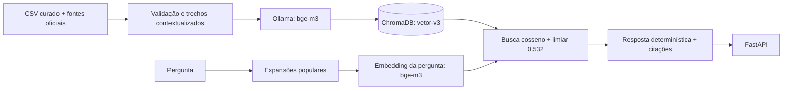

# RAG do Assistente Virtual

Este diretório contém o pipeline usado pela API: <br>
Validação das fontes, divisão em trechos, embeddings, recuperação com ChromaDB, respostas determinísticas, avaliação RAGAS (opcional) e testes.

## Arquitetura de produção (T5)

1. `programas_sociais_legislacao_links_oficiais.csv` fornece os **dados estruturados dos 42 programas**. As fichas em `base/` são geradas pelo CSV, por sua vez os documentos em `fontes/` preservam texto legislativo oficial baixado.
2. `dataset.py` valida colunas, registros e URLs, cria seções por programa e trechos da legislação. Os metadados mantêm nome, órgão informado, público, critérios, leis e fonte juntos.
3. `ingestao.py` envia os trechos em lotes ao Ollama para obter embeddings com `bge-m3` e persiste-os no ChromaDB com distância cosseno.
4. A busca expande expressões populares, consulta a versão atual do corpus e deduplica resultados por programa. O limiar `RAG_MIN_SIMILARITY` (padrão `0.532`) descarta candidatos de baixa similaridade.
5. `compose_answer()` monta a resposta com campos revisados da base: primeiro programa completo, referências numéricas e, quando houver, apenas os nomes dos próximos resultados. **Não há classificação nem geração de resposta por LLM.**
6. A API entrega resposta e referências. O resultado não confirma elegibilidade.

O limiar **0.532** foi medido no corpus menor usado no relatório da Semana 3. O corpus atual inclui textos legislativos adicionais, valide ou recalibre o limiar com perguntas de validação separadas antes de uso real.



## RAGAS

O RAGAS avalia respostas do fluxo real, mas não gera a resposta do produto. Por padrão, o juiz é `qwen2.5:3b` no endpoint OpenAI-compatível local do Ollama. A avaliação não exige chave OpenAI nem gera custo de API. <br>
Configure `OLLAMA_EVALUATION_MODEL` para outro modelo local.

Instalação e execução (opcional):

```powershell
python -m pip install -r .\Dados-RAG\RAG\requirements-avaliacao.txt
ollama pull qwen2.5:3b
python .\Dados-RAG\RAG\avaliar_ragas.py todos --limite 2
python .\Dados-RAG\RAG\avaliar_ragas.py todos
```

A avaliação coleta as **27 perguntas** versionadas em `avaliacao/casos.jsonl`, incluindo **seis perguntas fora do escopo**. **Faithfulness** e **Context Utilization** comparam a resposta determinística aos contextos recuperados, **Context Precision** e **Context Recall** usam também as referências do arquivo de casos. Essas quatro métricas usam um **juiz LLM local** e as notas dependem da qualidade desse modelo e da referência.

As **métricas RAGAS** de resposta/contexto são calculadas somente nos **casos em escopo**. O juiz `qwen2.5:3b` interpretou incorretamente um teste de abstenção, então aderência ao escopo não é apresentada como uma nota subjetiva: `acerto_top_1`, `acerto_top_k`, `resposta_com_contexto_em_escopo`, `abstencao_correta` e `decisao_escopo_correta` são verificações objetivas baseadas no programa esperado e no escopo declarado no conjunto. Esses indicadores não são métricas RAGAS. As referências dos casos foram redigidas a partir da base local, trate Context Precision/Recall como exploratórias até revisar essas referências. `acerto_top_k` mede se o programa esperado aparece nos resultados, não se a resposta que destaca o primeiro resultado está correta.

Para medir ranking da recuperação e abstenção sem juiz LLM:

```powershell
python .\Dados-RAG\RAG\avaliar.py
```

## Testes locais

```powershell
python .\Dados-RAG\RAG\testes-automatizados\executar_testes.py
```

O comando roda os testes unitários do back-end e do RAG, sem precisar do Ollama. Use `--com-ragas` para acrescentar a avaliação local integrada, veja `testes-automatizados/COMO_EXECUTAR.txt`.

## Atualização do índice

Depois de atualizar o CSV ou as fontes oficiais:

```powershell
python .\Dados-RAG\RAG\baixar_fontes.py
python .\Dados-RAG\RAG\ingestao.py
```

O **banco vetorial** é derivado e fica por padrão em `%LOCALAPPDATA%\AssistenteVirtualDF\vetor-v3` no Windows. `VECTOR_DB_PATH`, `OLLAMA_URL`, `OLLAMA_EMBEDDING_MODEL` e `RAG_MIN_SIMILARITY` podem ser configurados por variáveis de ambiente.

## Limitações

- Há **42 programas federais**, o conjunto não representa todos os benefícios do DF.
- Critérios ausentes ou parciais permanecem explicitamente incompletos.
- A similaridade do embedding não prova que a pergunta é social nem que o resultado é elegível. Uma recusa por limiar pode ser incorreta.
- As métricas da Semana 3 são resultados experimentais no conjunto testado, não garantia de precisão em produção.
