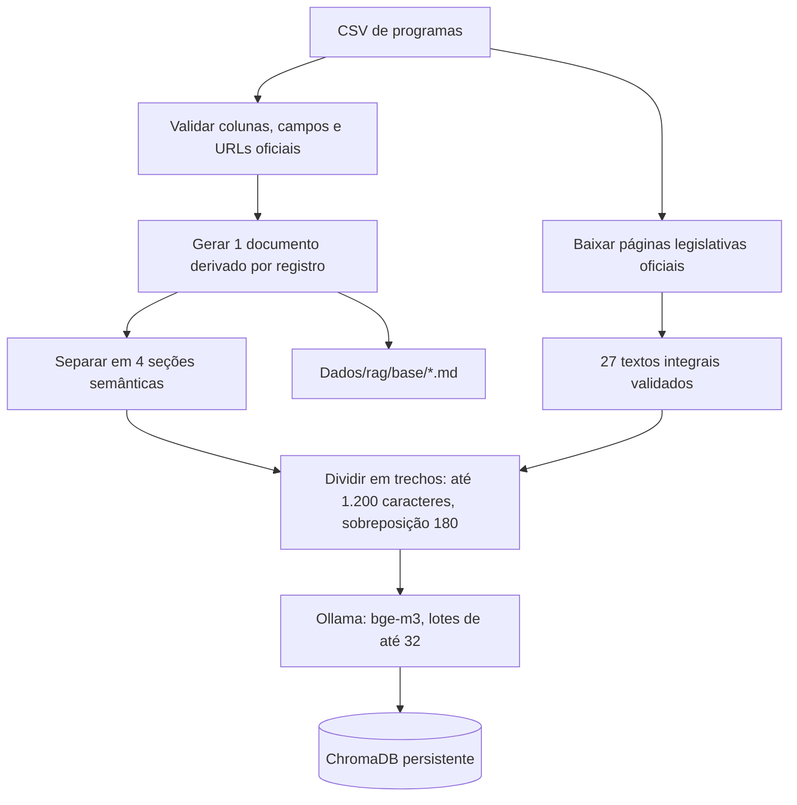
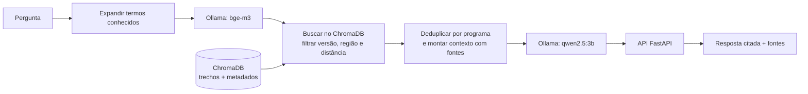

# Semana 2 — Base de Conhecimento + Protótipo de RAG

**RES IA ELD UNB — Grupo 7**

Este documento descreve o estado verificável do projeto em relação ao entregável da semana 2. O protótipo já implementa ingestão, busca vetorial e geração de respostas com referências. <br>
Porém isso não significa que todos os requisitos de curadoria e demonstração estejam comprovados.

## Entregável

| Requisito Solicitado | Estado no projeto |
|---|---|
| Base de conhecimento curada | ⚠️ **Parcial.** Há um CSV com 42 registros de programas sociais federais e 27 textos integrais de legislação baixados de páginas oficiais e incluídos no índice. Os critérios continuam parciais em vários registros; os textos legais não substituem a revisão das regras operacionais e do catálogo completo do DF. |
| Mínimo de 20 documentos-fonte | ✅ **Concluído tecnicamente:** 27 textos legislativos integrais de URLs oficiais distintas foram coletados e indexados. Dois links retornam PDFs ainda não extraídos e uma página retornou erro temporário. |
| Estratégia de chunking | ✅ Cada registro vira quatro seções semânticas contextualizadas; os textos legislativos também são divididos em trechos. Cada trecho tem até 1.200 caracteres, com sobreposição de 180 caracteres e ajuste de fronteira por espaço. O índice atual contém 168 trechos estruturados e 1.036 legislativos (1.204 no total). |
| Estratégia de embeddings | ✅ Implementada com o modelo local `bge-m3`, executado pelo Ollama. O mesmo modelo transforma os trechos na ingestão e as perguntas na consulta; a ingestão processa lotes de até 32 trechos. |
| Banco vetorial | ✅ **ChromaDB** persistente, coleção `fontes_oficiais_df` e distância cosseno. No Windows, o caminho padrão é `%LOCALAPPDATA%\AssistenteVirtualDF\vetor-v2`; `VECTOR_DB_PATH` permite configurar outro caminho. O índice é derivado e pode ser recriado a partir do CSV e das fontes baixadas. |

### Fluxo de ingestão



### Arquitetura do protótipo



### Para que serve o RAG

RAG significa **Retrieval-Augmented Generation** (**Geração Aumentada por Recuperação**). Em vez de pedir ao modelo que responda apenas com o que aprendeu no treinamento, o sistema primeiro procura trechos relacionados à pergunta no índice vetorial e envia esses trechos como contexto ao modelo. Neste projeto, isso ajuda a relacionar perguntas em linguagem cotidiana aos programas da base e a apresentar as referências usadas. <br>
⚠️ **Não garante que toda resposta esteja correta**: os dados recuperados podem estar incompletos e a resposta ainda precisa ser conferida nas fontes oficiais.

Neste projeto, o CSV fornece os registros estruturados e os textos legais oficiais ampliam a base indexada. O `bge-m3` converte esses trechos e as perguntas em vetores para localizar conteúdos semelhantes; o ChromaDB guarda e consulta esses vetores; o `qwen2.5:3b` redige a resposta usando os trechos encontrados. Os Markdown em `BancoDeDadoseRAG/rag/base/` são versões derivadas dos registros, não cópias integrais dos documentos citados nos links.

## Demonstração

O código oferece uma consulta de recuperação pela linha de comando e o fluxo de resposta completa pela API/chat. Para a apresentação, execute o sistema com Ollama e os modelos disponíveis:

```powershell
ollama pull bge-m3
ollama pull qwen2.5:3b
python .\Dados\rag\baixar_fontes.py
python .\Dados\rag\ingestao.py
python -m uvicorn main:app --reload --app-dir .\Back-end
```

Em outro terminal, demonstre a recuperação de trechos e suas referências:

```powershell
python .\Dados\rag\buscar.py "Tem ajuda para comprar o botijão de gás?"
```

Esse comando mostra o nome do programa, órgão informado, similaridade, documento, URL e trecho recuperado. Para demonstrar a resposta fundamentada, envie a mesma pergunta ao chat/API e registre a resposta e as fontes exibidas. O comando de busca sozinho demonstra recuperação, não geração da resposta.

Com a API em execução, envie a pergunta ao endpoint de chat para demonstrar a geração e as citações:

```powershell
$body = @{
    conversation_id = [guid]::NewGuid().ToString()
    question = "Tem ajuda para comprar o botijão de gás?"
    input_mode = "text"
    history = @()
} | ConvertTo-Json -Depth 5

Invoke-RestMethod -Uri "http://127.0.0.1:8000/api/chat" `
    -Method Post -ContentType "application/json" -Body $body |
    ConvertTo-Json -Depth 8
```

Registre a resposta, as citações (`title`, `url` e trecho) e confira manualmente se as fontes sustentam as afirmações. Os resultados apresentados de `avaliar.py` não devem ser usados como prova de veracidade, pois ele mede somente se o programa esperado aparece entre os cinco primeiros resultados.

| Demonstração | Estado |
|---|---|
| Consulta submetida | ✅ Consulta real executada: “Tem ajuda para comprar o botijão de gás?”. |
| Recuperação de chunks/documentos | ✅ `buscar.py` recuperou trechos do Auxílio Gás e do Bolsa Família, incluindo legislação oficial, com similaridade e URLs. |
| Resposta fundamentada | ✅ Chamada real a `POST /api/chat` respondeu HTTP 200 com resposta gerada e citações. |
| Evidência das fontes | ✅ A resposta incluiu a Lei nº 15.348/2026 e a Lei nº 14.601/2023, com os URLs oficiais retornados pela API. A conferência humana de cada afirmação continua necessária. |

O índice foi recriado com 1.204 vetores e reaberto em um processo novo; os arquivos HNSW foram confirmados no caminho local do Windows. O índice antigo em `BancoDeDadoseRAG/vetor/` continua sem os arquivos necessários e não é usado. O teste de recuperação definido no projeto obteve **11/11 (100%)**; esse resultado mede somente a posição do programa esperado, não a veracidade da resposta.

## Documentação e arquivos relacionados

- Implementação, configuração, limitações e comandos: [`BancoDeDadoseRAG/rag/README.md`](../BancoDeDadoseRAG/rag/README.md).
- Coleta e extração de legislação oficial: [`BancoDeDadoseRAG/rag/baixar_fontes.py`](../BancoDeDadoseRAG/rag/baixar_fontes.py) e [`BancoDeDadoseRAG/rag/fontes.py`](../BancoDeDadoseRAG/rag/fontes.py).
- Código de ingestão: [`BancoDeDadoseRAG/rag/ingestao.py`](../BancoDeDadoseRAG/rag/ingestao.py).
- Preparação da base e criação de trechos: [`BancoDeDadoseRAG/rag/dataset.py`](../BancoDeDadoseRAG/rag/dataset.py).
- Busca vetorial, embeddings e geração: [`BancoDeDadoseRAG/rag/rag.py`](../BancoDeDadoseRAG/rag/rag.py).
- Consulta de demonstração da recuperação: [`BancoDeDadoseRAG/rag/buscar.py`](../BancoDeDadoseRAG/rag/buscar.py).
- Base de entrada: [`BancoDeDadoseRAG/programas_sociais_legislacao_links_oficiais.csv`](../BancoDeDadoseRAG/programas_sociais_legislacao_links_oficiais.csv).

## Verificação automatizada

Execute a partir da raiz do projeto, com o ambiente virtual ativado:

```powershell
python -m unittest discover -s .\Back-end -p "test_*.py"
python -m unittest discover -s .\Dados\rag -p "test_*.py"
```

- [x] Testes do RAG e da base: **20 passaram**.
- [x] Testes do back-end: **11 passaram**.
