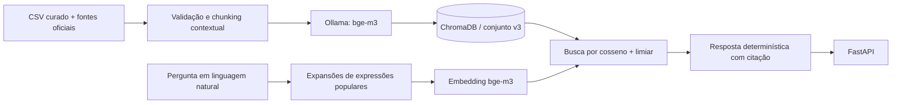

# Semana 3 — arquitetura escolhida para o RAG

## Decisão

O relatório **LLM x RAG — Semana 3** concluiu que a configuração T5 teve o melhor resultado no conjunto experimental: embeddings `bge-m3`, limiar de abstenção e resposta por texto determinístico extraído da ficha do programa, sem LLM na geração.

Esta arquitetura foi aplicada ao fluxo da API:



### Fluxo em detalhes

1. `Dados-RAG/programas_sociais_legislacao_links_oficiais.csv` é a fonte estruturada de 42 programas federais. As fichas Markdown em `Dados-RAG/RAG/base/` são derivadas desse CSV.
2. O coletor `Dados-RAG/RAG/baixar_fontes.py` obtém documentos legislativos de endereços oficiais; `fontes.py` valida e persiste os textos em `Dados-RAG/RAG/fontes/`.
3. `dataset.py` valida o CSV e constrói trechos contextualizados com o programa, público, critérios, legislação e referência de origem.
4. `ingestao.py` calcula embeddings com `bge-m3` pelo Ollama e grava os vetores no ChromaDB.
5. A busca expande termos populares, recupera até quatro programas e aplica `RAG_MIN_SIMILARITY`. O padrão inicial é `0.532`.
6. `compose_answer()` monta a resposta com campos diretamente da base: programa principal, público, critérios disponíveis, legislação e citação. Os próximos resultados são apresentados apenas pelo nome.
7. A API entrega a resposta e as fontes. Ela não usa um LLM para classificar ou redigir respostas, não consulta serviços pagos e não decide elegibilidade.

## O que mostrou o experimento

No conjunto do relatório, com 21 perguntas em escopo e 6 fora:

| Configuração | Programa correto | Lei correta | Abstenção correta fora | Latência média |
|---|---:|---:|---:|---:|
| T1 — LLM pura | 10% | 0% | 100% | 1,1 s |
| T2 — RAG + resposta fixa | 90% | 90% | 0% | 0,1 s |
| T3 — RAG + LLM | 67% | 5% | 100% | 7,2 s |
| T4 — BGE + limiar + LLM | 76% | 10% | 100% | 5,7 s |
| T5 — BGE + limiar + resposta fixa | 100% | 100% | 100% | 0,2 s |

O relatório registrou acerto@4 de 100% para `bge-m3` com expansão, margem de separação de 0,08 e limiar 0,532. Esses números são resultados do conjunto experimental do relatório, não uma garantia de qualidade ou de elegibilidade.

## Como isso afeta RAGAS

RAGAS avalia a implementação real, mas está fora do caminho de resposta do produto. Ao usar um juiz LLM, mesmo que apenas na avaliação, pode haver custo se o provedor for remoto. O avaliador foi configurado para apontar ao endpoint OpenAI-compatível **local** do Ollama. O juiz padrão é `qwen2.5:3b`; não é necessária chave `OPENAI_API_KEY` e não há cobrança de API.

O juiz local é opcional e pode produzir avaliações imperfeitas. Em uma checagem, o Qwen 3B identificou corretamente no texto que uma recusa a uma pergunta sobre futebol era adequada, mas atribuiu nota zero à métrica AspectCritic. Por isso, o avaliador não usa essa métrica para classificar escopo: `acerto_top_1`, `acerto_top_k`, `resposta_com_contexto_em_escopo`, `abstencao_correta` e `decisao_escopo_correta` são calculadas diretamente a partir dos casos anotados; não são métricas RAGAS. As métricas RAGAS de fidelidade e contexto são executadas só nas perguntas em escopo.

As referências do conjunto foram redigidas com base na própria planilha, mas ainda não passaram por validação humana independente. Context Precision e Context Recall são exploratórias até a revisão dessas referências.

A reavaliação da base atual marcou o programa esperado em **18/21 buscas no top-1** e **21/21 no top-4**, com abstenção em **6/6** perguntas fora do escopo; o MRR foi 0,921. O top-4 não garante que o programa detalhado na resposta seja o correto. Perguntas que aceitam vários programas devem ter todos eles anotados como relevantes antes de interpretar o top-1 como erro.

## Mudanças no código

- Removidas a classificação e a geração OpenAI do fluxo de produção.
- Removida a busca lexical do endpoint `/api/assistant`; ele usa agora a mesma busca vetorial da rota de chat.
- Adicionados metadados estruturados às fichas indexadas, para produzir respostas sem reescrita por modelo.
- O conjunto mudou para v3; o índice antigo não deve ser reutilizado. Rode novamente `ingestao.py`.
- O código foi ajustado à estrutura real do repositório, que usa `Dados-RAG/RAG` e não `Dados/rag`.
- O comando de testes unitários agora cobre back-end e RAG sem iniciar Ollama ou RAGAS. A avaliação RAGAS é um passo explícito opcional.

## Limitações e próximos passos

- O limiar 0,532 foi calibrado no corpus menor do relatório e com as mesmas perguntas usadas para medir os resultados. A base atual indexa também documentos legislativos e tem distribuição de scores diferente. Calibre novamente com exemplos independentes e mantenha um conjunto de teste separado.
- Similaridade vetorial é uma estimativa, não uma compreensão garantida da intenção. Uma pergunta fora de escopo pode coincidir com um tema social; uma dúvida válida pode ficar abaixo do limiar. A resposta de abstenção deve ser tratada como “não encontrei evidência”, não como classificação definitiva do assunto.
- A base reúne 42 programas federais, não um catálogo completo do DF. Critérios parciais ou ausentes devem continuar sendo revisados por especialistas.
- O conjunto de 27 perguntas é pequeno. Amplie-o (incluindo pelo menos 15 perguntas fora de escopo) e revise referências e respostas antes de disponibilizar o assistente para uso institucional.

## Comandos

Na raiz do repositório, após instalar as dependências do back-end e obter `bge-m3`:

```powershell
python .\Dados-RAG\RAG\ingestao.py
python .\Dados-RAG\RAG\testes-automatizados\executar_testes.py
```

Para acrescentar RAGAS com juiz local:

```powershell
python -m pip install -r .\Dados-RAG\RAG\requirements-avaliacao.txt
ollama pull qwen2.5:3b
python .\Dados-RAG\RAG\testes-automatizados\executar_testes.py --com-ragas
```
