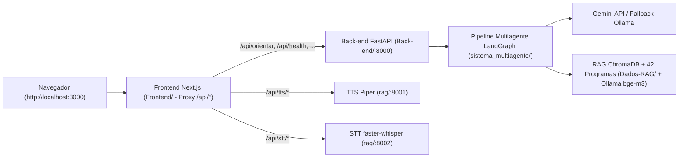

# 🏡 GuIA Social — Assistente Virtual de Benefícios Sociais

Assistente virtual informativo e multimodal (texto, voz e Libras) desenvolvido para ajudar cidadãos a identificar **programas e benefícios sociais federais** relacionados à sua situação, com linguagem simples, acessibilidade e referências oficiais ancoradas em uma base de **42 programas**.

> [!IMPORTANT]
> **Aviso institucional (Premissa P02):** este sistema tem caráter **exclusivamente informativo**. Ele **não** realiza cadastro, **não** consulta CPF nem o CadÚnico, **não** confirma elegibilidade individual e **não** substitui o atendimento presencial no CRAS, CREAS ou órgão gestor responsável. Confirme sempre as regras vigentes nas fontes oficiais indicadas.

---

## Sumário

1. [Visão Geral e Arquitetura](#visão-geral-e-arquitetura)
2. [Mapa de Serviços e Portas](#mapa-de-serviços-e-portas)
3. [Pré-requisitos](#pré-requisitos)
4. [Configuração de Variáveis de Ambiente (`.env`)](#configuração-de-variáveis-de-ambiente-env)
5. [Execução Rápida com Docker Compose (Stack Completa)](#execução-rápida-com-docker-compose-stack-completa)
6. [Execução Local do Back-end (Sem Docker)](#execução-local-do-back-end-sem-docker)
7. [Execução Local do Frontend (Sem Docker)](#execução-local-do-frontend-sem-docker)
8. [Serviços Locais de Voz — TTS e STT (Opcional no Modo Local)](#serviços-locais-de-voz--tts-e-stt-opcional-no-modo-local)
9. [Execução do Sistema Multiagente via CLI](#execução-do-sistema-multiagente-via-cli)
10. [Variáveis de Ambiente — Referência Rápida](#variáveis-de-ambiente--referência-rápida)
11. [Principais Endpoints da API](#principais-endpoints-da-api)
12. [Estrutura do Repositório](#estrutura-do-repositório)
13. [Testes Automatizados](#testes-automatizados)
14. [Solução de Problemas Comuns](#solução-de-problemas-comuns)
15. [Privacidade (LGPD) e Limitações Conhecidas](#privacidade-lgpd-e-limitações-conhecidas)
16. [Documentação Complementar](#documentação-complementar)
17. [Colaboradores](#colaboradores)

---

## Visão Geral e Arquitetura

A aplicação combina um **Frontend Next.js acessível**, uma **API FastAPI** integrada a um **pipeline multiagente em LangGraph**, recuperação documental (**RAG**) sobre 42 programas oficiais e **serviços locais de voz** (TTS e STT) em português:

- **Frontend (`Frontend/`)**: Next.js 16, React 19 e TypeScript. Renderização segura de Markdown, cards de programas em linguagem simples, seção separada para mensagens de apoio/proteção, painel de acessibilidade (fonte 100–150%, alto contraste, destaque de links, espaçamento, redução de movimento), widget oficial do **VLibras** e controles de voz.
- **Back-end (`Back-end/` + `sistema_multiagente/`)**: Python 3 (3.12+), FastAPI, Uvicorn, Pydantic e **LangGraph**. O chat consome `POST /api/orientar`, que executa:
  - **Guardrail**: validação de escopo socioassistencial, bloqueio P02, resposta dupla com canais oficiais de apoio/proteção (risco de autoextermínio e matéria penal) e seleção dinâmica entre 3 padrões agênticos (`padrao`, `rewoo` e `reflexion`).
  - **Resiliência em 4 camadas**: (1) modelos **Google Gemini** por tiers cognitivos (`rapido`, `equilibrado`, `analitico`) com retry (`tenacity`) e circuit breaker com cooldown/TTL; (2) provedor secundário opt-in (**Ollama local** ou **OpenAI-compatible** via `LLM_FALLBACK_ORDER`); (3) degradação graciosa no grafo preservando rascunho/parecer; (4) fallback determinístico ancorado nas fichas do RAG local (`sucesso_degradado`).
- **Base de Conhecimento e RAG (`Dados-RAG/`)**: 42 programas federais estruturados em CSV, 42 fichas Markdown derivadas e textos legislativos oficiais, indexados no **ChromaDB** com embeddings `bge-m3` via **Ollama** (com fallback automático de coleção local em `rag/chroma_db/` para o multiagente quando o Ollama não está ativo).
- **Voz Local (`rag/`)**: síntese de voz (**Piper**, `pt_BR-faber-medium`, porta `8001`) e transcrição de microfone (**faster-whisper**, `small` + `large-v3-turbo`, porta `8002`), ambos em CPU e sem chave de API.



> [!NOTE]
> O proxy em [`Frontend/next.config.mjs`](Frontend/next.config.mjs) encaminha `/api/*`, `/api/tts/*` e `/api/stt/*` diretamente pelo servidor Next.js, evitando problemas de CORS no navegador.

---

## Mapa de Serviços e Portas

| Serviço | Diretório / Arquivo | Porta Padrão | Obrigatório? | Verificação / Acesso |
| --- | --- | --- | --- | --- |
| **Frontend (GuIA Social)** | `Frontend/` | `3000` | Sim | `http://localhost:3000` |
| **Back-end (FastAPI + LangGraph)** | `Back-end/main.py` | `8000` | Sim | `http://127.0.0.1:8000/api/health` e `/docs` |
| **Ollama (Embeddings `bge-m3` / LLM local)** | Serviço externo / container | `11434` | Recomendado\* | `http://127.0.0.1:11434` |
| **TTS — Leitura em voz alta (Piper)** | `rag/tts_service.py` | `8001` | Opcional (áudio) | `http://127.0.0.1:8001/api/tts/health` |
| **STT — Microfone (faster-whisper)** | `rag/stt_service.py` | `8002` | Opcional (microfone) | `http://127.0.0.1:8002/api/stt/health` |

\* O **chat por texto** funciona apenas com **Back-end (`:8000`) + Frontend (`:3000`)**. O **Ollama** é necessário para indexação completa com `bge-m3` (via `Back-end/bootstrap.py`), para as rotas legadas `/api/assistant` e `/api/chat` e para o fallback LLM local (`LLM_FALLBACK_ORDER=ollama`). Caso rode apenas `/api/orientar` com Gemini sem Ollama, o `sistema_multiagente/rag.py` usa automaticamente o índice local em `rag/chroma_db/`.

> [!WARNING]
> **Atenção ao nome da pasta do frontend:** use sempre **`Frontend/`** (interface ativa integrada ao multiagente, voz, acessibilidade e `docker-compose.yml`). A pasta `Front-end/` é um protótipo legado mantido apenas para histórico.

---

## Pré-requisitos

### Para execução com Docker (recomendado para subir tudo junto)
- **Git**
- **Docker** e **Docker Compose** (v2+)
- Chave da API do Google Gemini (`GOOGLE_API_KEY`) **ou** uso do modo fallback com **Ollama** local

### Para execução local (sem Docker)
- **Git**
- **Python 3** (3.12 ou superior; comando `python3` no macOS/Linux ou `py -3` / `python` no Windows — as imagens Docker utilizam Python 3.12)
- **Node.js 24+** e **npm** (o `Frontend/Dockerfile` utiliza `node:24-alpine`; os testes do frontend utilizam `node --experimental-strip-types`)
- **Ollama** instalado e em execução (recomendado para embeddings `bge-m3` e/ou fallback LLM local)
- Chave da API do Google Gemini (`GOOGLE_API_KEY`) obtida no [Google AI Studio](https://aistudio.google.com/apikey) **ou** configuração de fallback via Ollama local

---

## Configuração de Variáveis de Ambiente (`.env`)

Antes de subir o Back-end (com ou sem Docker), clone o repositório e crie o arquivo `.env` na **raiz do projeto** a partir de [`.env.example`](.env.example):

**macOS / Linux (bash/zsh):**
```bash
git clone https://github.com/purpleaither/SegundoChallenge.git
cd SegundoChallenge
cp .env.example .env
```

**Windows (PowerShell):**
```powershell
git clone https://github.com/purpleaither/SegundoChallenge.git
cd SegundoChallenge
Copy-Item .env.example .env
```

Escolha um dos modos abaixo para preencher o `.env`:

### Modo A — Google Gemini (padrão)
```env
GOOGLE_API_KEY=COLE_SUA_CHAVE_AQUI
# Alternativa aceita: GEMINI_API_KEY=...
```

### Modo B — Gemini + Fallback Local com Ollama (alta resiliência)
```env
GOOGLE_API_KEY=COLE_SUA_CHAVE_AQUI
LLM_FALLBACK_ORDER=ollama
OLLAMA_LLM_MODEL=qwen2.5:7b
```

### Modo C — 100% Local com Ollama (sem chave Gemini)
```env
LLM_FALLBACK_ORDER=ollama
OLLAMA_URL=http://127.0.0.1:11434
OLLAMA_LLM_MODEL=qwen2.5:7b
```
*(No Docker Compose, `OLLAMA_URL` já é apontado internamente para `http://ollama:11434`.)*

> [!CAUTION]
> **Segurança:** nunca versionar o arquivo `.env` nem declarar chaves de API dentro de `Frontend/` ou com prefixo `NEXT_PUBLIC_`. O Back-end valida a presença de `GOOGLE_API_KEY`, `GEMINI_API_KEY` ou `LLM_FALLBACK_ORDER`; sem nenhuma dessas variáveis configuradas, `POST /api/orientar` retorna **HTTP 503** explicitamente.

---

## Execução Rápida com Docker Compose (Stack Completa)

O [`docker-compose.yml`](docker-compose.yml) sobe toda a stack integrada: **Ollama (`bge-m3`) → Back-end (`:8000`) + TTS (`:8001`) + STT (`:8002`) → Frontend (`:3000`)**.

Na **raiz do repositório** (com o `.env` já configurado):

```bash
docker compose up --build
```

Para rodar em segundo plano (detached):

```bash
docker compose up -d --build
```

### O que acontece na primeira inicialização
1. `ollama` sobe e `ollama-pull` baixa o modelo de embeddings `bge-m3` (~1,2 GB), encerrando em seguida.
2. `backend` executa `Back-end/bootstrap.py` para indexar a base no ChromaDB (pode levar alguns minutos em CPU na primeira vez) e inicia o Uvicorn na porta `8000`.
3. `tts` (Piper `pt_BR-faber-medium`) e `stt` (faster-whisper `small` + `large-v3-turbo`) baixam os pesos durante o build e sobem nas portas `8001` e `8002`.
4. `frontend` aguarda `backend`, `tts` e `stt` atingirem o status `healthy` e disponibiliza a interface em **`http://localhost:3000`**.

Modelos e índices ficam persistidos nos volumes Docker (`ollama`, `chroma-v3` e `backend-data`), tornando as inicializações seguintes bem mais rápidas.

### Comandos úteis no Docker
```bash
# Verificar status e healthchecks dos containers
docker compose ps

# Acompanhar logs do back-end e do frontend
docker compose logs -f backend frontend

# (Opcional) Baixar o modelo LLM local dentro do container Ollama para usar LLM_FALLBACK_ORDER=ollama
docker compose exec ollama ollama pull qwen2.5:7b

# Encerrar containers (mantendo volumes e modelos baixados)
docker compose down
```

---

## Execução Local do Back-end (Sem Docker)

Todos os comandos desta seção devem ser executados a partir da **raiz do repositório** (`SegundoChallenge/`), no **Terminal 1**.

### Passo 1 — Criar ambiente virtual e instalar dependências

O arquivo [`Back-end/requirements.txt`](Back-end/requirements.txt) já inclui automaticamente as dependências do `sistema_multiagente/requirements.txt` (FastAPI, Uvicorn, ChromaDB, LangGraph, LangChain/Gemini, Pydantic, Tenacity e HTTPX).

**macOS / Linux (bash/zsh):**
```bash
python3 -m venv .venv
source .venv/bin/activate
python3 -m pip install --upgrade pip
python3 -m pip install -r Back-end/requirements.txt
```

**Windows (PowerShell):**
```powershell
py -3 -m venv .venv
.\.venv\Scripts\Activate.ps1
python -m pip install --upgrade pip
python -m pip install -r .\Back-end\requirements.txt
```
*(Se no Windows o comando `py` não estiver instalado, substitua `py -3` por `python`.)*

### Passo 2 — Preparar o Ollama e o índice vetorial RAG

Com o serviço do Ollama em execução (se necessário, execute `ollama serve` em um terminal separado):

```bash
# Baixar o modelo de embeddings usado na indexação oficial
ollama pull bge-m3

# (Opcional) Baixar o modelo LLM local caso utilize LLM_FALLBACK_ORDER=ollama
ollama pull qwen2.5:7b
```

Em seguida, gere/verifique o índice vetorial ChromaDB com o script idempotente [`Back-end/bootstrap.py`](Back-end/bootstrap.py) (ele só reindexa se o corpus ou o código do RAG tiver mudado):

**macOS / Linux (com o `.venv` ativo):**
```bash
python3 Back-end/bootstrap.py
```

**Windows (PowerShell, com o `.venv` ativo):**
```powershell
python .\Back-end\bootstrap.py
```

<details>
<summary>Opções avançadas de ingestão e execução sem Ollama</summary>

- **Atualizar textos legislativos oficiais** (os documentos em `Dados-RAG/RAG/fontes/` já vêm no repositório; rode novamente apenas se quiser baixar versões novas):
  ```bash
  python3 Dados-RAG/RAG/baixar_fontes.py
  ```
- **Forçar reindexação completa** manualmente (após editar o CSV ou arquivos de fontes):
  ```bash
  python3 Dados-RAG/RAG/ingestao.py
  ```
- *(No Windows PowerShell, use `python .\Dados-RAG\RAG\...` com o `.venv` ativo.)*
- **Onde o índice vetorial fica salvo:** controlado por `VECTOR_DB_PATH`. Sem a variável, o padrão é `Dados-RAG/vetor-v3` no macOS/Linux e `%LOCALAPPDATA%\AssistenteVirtualDF\vetor-v3` no Windows.
- **Rodar apenas `/api/orientar` sem Ollama:** se você configurou `GOOGLE_API_KEY` e não pretende usar o Ollama nem as rotas `/api/assistant` e `/api/chat`, pode pular o Passo 2 — na primeira consulta, `sistema_multiagente/rag.py` criará automaticamente uma coleção local do ChromaDB em `rag/chroma_db/`.

</details>

### Passo 3 — Iniciar o servidor FastAPI (porta `8000`)

**Modo desenvolvimento (com recarregamento automático `--reload`):**

**macOS / Linux (com o `.venv` ativo):**
```bash
python3 -m uvicorn main:app --reload --app-dir Back-end --host 127.0.0.1 --port 8000
```

**Windows (PowerShell, com o `.venv` ativo):**
```powershell
python -m uvicorn main:app --reload --app-dir .\Back-end --host 127.0.0.1 --port 8000
```

**Modo recomendado para privacidade / LGPD (sem logs de acesso HTTP):**

**macOS / Linux:**
```bash
python3 -m uvicorn main:app --app-dir Back-end --host 127.0.0.1 --port 8000 --no-access-log
```

**Windows (PowerShell):**
```powershell
python -m uvicorn main:app --app-dir .\Back-end --host 127.0.0.1 --port 8000 --no-access-log
```

> [!TIP]
> Se abrir um novo terminal sem ativar o ambiente virtual (`source .venv/bin/activate` no macOS/Linux ou `.\.venv\Scripts\Activate.ps1` no Windows), substitua `python3` / `python` por `./.venv/bin/python3` (macOS/Linux) ou `.\.venv\Scripts\python.exe` (Windows). Sempre reinicie o Uvicorn após alterar variáveis no `.env`.

### Passo 4 — Verificar se o Back-end está saudável

Com o servidor rodando, verifique no navegador ou via `curl`:

```bash
# 1. Disponibilidade da API -> esperado: {"status":"ok"}
curl http://127.0.0.1:8000/api/health

# 2. Configuração do pipeline multiagente -> esperado: "configured": true
curl http://127.0.0.1:8000/api/assistant/status
```

- **Documentação interativa (Swagger UI):** `http://127.0.0.1:8000/docs`

---

## Execução Local do Frontend (Sem Docker)

Com o Back-end ativo na porta `8000`, abra um **novo terminal (Terminal 2)** e entre na pasta **`Frontend/`**:

### Modo desenvolvimento (`next dev`)

**macOS / Linux / Windows:**
```bash
cd Frontend
npm ci
npm run dev
```

Acesse a aplicação em **`http://localhost:3000`**.

> *(Na segunda execução em diante, basta rodar `npm run dev` dentro de `Frontend/`.)*

### Modo produção local (`next build` + `next start`)

```bash
cd Frontend
npm ci
npm run typecheck
npm run build
npm run start
```

### Personalizar endereços do Back-end, TTS e STT no Frontend

Por padrão, [`Frontend/next.config.mjs`](Frontend/next.config.mjs) redireciona todas as chamadas da interface para serviços locais:

- `/api/*` → `BACKEND_URL` (padrão: `http://127.0.0.1:8000`)
- `/api/tts/*` → `TTS_URL` (padrão: `http://127.0.0.1:8001`)
- `/api/stt/*` → `STT_URL` (padrão: `http://127.0.0.1:8002`)

Para apontar para outros hosts ou portas, crie `Frontend/.env.local` (ignorado pelo Git):

```env
BACKEND_URL=http://127.0.0.1:8000
TTS_URL=http://127.0.0.1:8001
STT_URL=http://127.0.0.1:8002
```

> [!NOTE]
> Os rewrites do Next.js são avaliados na inicialização do `next dev` e **fixados durante o `next build`**. Reinicie o servidor de desenvolvimento (ou refaça `npm run build` / `docker compose up --build`) sempre que alterar essas URLs.

---

## Serviços Locais de Voz — TTS e STT (Opcional no Modo Local)

O chat por texto funciona normalmente sem estes serviços. Para habilitar a **leitura em voz alta** (botão *Ouvir*) e a **digitação por voz** (botão *Microfone*) no modo local, inicie os serviços abaixo em terminais adicionais a partir da pasta `rag/`.

### 1. TTS — Leitura em voz alta com Piper (Terminal 3 — porta `8001`)

**macOS / Linux:**
```bash
cd rag
python3 -m venv .venv-tts
.venv-tts/bin/python3 -m pip install -r requirements-tts.txt
.venv-tts/bin/python3 -m piper.download_voices pt_BR-faber-medium --data-dir voices
.venv-tts/bin/python3 -m uvicorn tts_service:app --host 127.0.0.1 --port 8001 --no-access-log
```

**Windows (PowerShell):**
```powershell
cd rag
py -3 -m venv .venv-tts
.\.venv-tts\Scripts\python.exe -m pip install -r requirements-tts.txt
.\.venv-tts\Scripts\python.exe -m piper.download_voices pt_BR-faber-medium --data-dir voices
.\.venv-tts\Scripts\python.exe -m uvicorn tts_service:app --host 127.0.0.1 --port 8001 --no-access-log
```

> [!NOTE]
> **macOS (`SSL: CERTIFICATE_VERIFY_FAILED` ao baixar a voz):** em instalações do Python 3 via `python.org`, execute uma vez `"/Applications/Python 3.x/Install Certificates.command"` (substituindo `3.x` pela versão instalada) ou instale `certifi` e rode o download com `SSL_CERT_FILE="$(.venv-tts/bin/python3 -m certifi)"`.

Verificação: `http://127.0.0.1:8001/api/tts/health` — detalhes em [`rag/TTS.md`](rag/TTS.md).

### 2. STT — Transcrição de microfone com faster-whisper (Terminal 4 — porta `8002`)

Baixa os modelos `small` (prévias progressivas durante a fala) e `large-v3-turbo` (revisão final), rodando 100% local em CPU (`int8`):

**macOS / Linux:**
```bash
cd rag
python3 -m venv .venv-stt
.venv-stt/bin/python3 -m pip install -r requirements-stt.txt
.venv-stt/bin/python3 -c "from faster_whisper import WhisperModel; [WhisperModel(name, device='cpu', compute_type='int8', download_root='models-stt') for name in ['small', 'large-v3-turbo']]"
STT_MODEL_DIR="$PWD/models-stt" .venv-stt/bin/python3 -m uvicorn stt_service:app --host 127.0.0.1 --port 8002 --no-access-log
```

**Windows (PowerShell):**
```powershell
cd rag
py -3 -m venv .venv-stt
.\.venv-stt\Scripts\python.exe -m pip install -r requirements-stt.txt
.\.venv-stt\Scripts\python.exe -c "from faster_whisper import WhisperModel; [WhisperModel(name, device='cpu', compute_type='int8', download_root='models-stt') for name in ['small', 'large-v3-turbo']]"
$env:STT_MODEL_DIR = "$PWD\models-stt"
.\.venv-stt\Scripts\python.exe -m uvicorn stt_service:app --host 127.0.0.1 --port 8002 --no-access-log
```

Verificação: `http://127.0.0.1:8002/api/stt/health` — requer `localhost` ou `HTTPS` e permissão de microfone no navegador. Detalhes em [`rag/STT.md`](rag/STT.md).

---

## Execução do Sistema Multiagente via CLI

Também é possível testar o pipeline LangGraph diretamente no terminal (sem precisar subir o FastAPI nem o Next.js), a partir da raiz do repositório com o `.venv` ativo:

```bash
# macOS / Linux (com .venv ativo; no Windows PowerShell, use `python`):

# Pergunta direta
python3 -m sistema_multiagente.main "Estou desempregada, tenho 2 filhos pequenos e não consigo pagar a conta de luz"

# Modo --debug (mostra padrão escolhido, modelos por agente, documentos recuperados e eventos de fallback)
python3 -m sistema_multiagente.main --debug "Posso acumular BPC com Bolsa Família?"

# Modo interativo
python3 -m sistema_multiagente.main
```

Consulte [`sistema_multiagente/README.md`](sistema_multiagente/README.md) para mais exemplos de prompts (`padrao`, `rewoo`, `reflexion` e resposta dupla).

---

## Variáveis de Ambiente — Referência Rápida

### Back-end e Multiagente (`.env` na raiz ou `sistema_multiagente/.env`)
| Variável | Padrão | Descrição |
| --- | --- | --- |
| `GOOGLE_API_KEY` | *(vazio)* | Chave da API Google Gemini (também aceita `GEMINI_API_KEY`). |
| `LLM_FALLBACK_ORDER` | *(vazio)* | Provedores secundários opt-in em ordem, ex.: `ollama` ou `ollama,openai_compat`. |
| `OLLAMA_URL` | `http://127.0.0.1:11434` | Endereço do servidor Ollama (embeddings `bge-m3` e fallback LLM). |
| `OLLAMA_LLM_MODEL` | `qwen2.5:7b` | Modelo LLM do Ollama usado no fallback (aceita overrides por tier `_RAPIDO`, `_EQUILIBRADO`, `_ANALITICO`). |
| `OLLAMA_NUM_CTX` | `8192` | Tamanho da janela de contexto enviada ao Ollama (mínimo `2048`). |
| `LLM_MAX_TENTATIVAS` | `2` | Máximo de tentativas por modelo em falhas transitórias (`429`/`503`/timeout). |
| `LLM_COOLDOWN_SEGUNDOS` | `60` | Cooldown base do circuit breaker para modelos em falha transitória. |
| `GEMINI_MODELO_RAPIDO` / `_EQUILIBRADO` / `_ANALITICO` | Tiers padrão em `config.py` | Override opcional do modelo principal Gemini por tier cognitivo. |
| `LLM_FALLBACK_BASE_URL` / `_API_KEY` / `_MODEL` | *(vazio)* | Credenciais do provedor `openai_compat` (somente se ativado explicitamente). |

### RAG e Dados (`Dados-RAG/` e `Back-end/`)
| Variável | Padrão | Descrição |
| --- | --- | --- |
| `OLLAMA_EMBEDDING_MODEL` | `bge-m3` | Modelo de embeddings usado na indexação e busca do `KnowledgeBase`. |
| `VECTOR_DB_PATH` | `Dados-RAG/vetor-v3` *(ou `%LOCALAPPDATA%\AssistenteVirtualDF\vetor-v3` no Windows)* | Caminho persistente do índice ChromaDB. |
| `RAG_MIN_SIMILARITY` | `0.532` | Limiar experimental de similaridade das rotas RAG determinísticas. |
| `AUDIO_LIMIT_DB` | `Back-end/data/audio_limits.sqlite3` | Banco SQLite de cota de áudio das rotas `/api/audio/*` e `/api/chat`. |

### Frontend e Serviços de Voz
| Variável | Padrão | Descrição |
| --- | --- | --- |
| `BACKEND_URL` | `http://127.0.0.1:8000` | Destino do proxy `/api/*` em `Frontend/next.config.mjs`. |
| `TTS_URL` | `http://127.0.0.1:8001` | Destino do proxy `/api/tts/*` em `Frontend/next.config.mjs`. |
| `STT_URL` | `http://127.0.0.1:8002` | Destino do proxy `/api/stt/*` em `Frontend/next.config.mjs`. |
| `TTS_MODEL_PATH` | `rag/voices/pt_BR-faber-medium.onnx` | Caminho alternativo do modelo ONNX do Piper (com `.onnx.json` ao lado). |
| `STT_MODEL_DIR` | Cache padrão do Hugging Face | Diretório local onde os modelos `faster-whisper` foram baixados. |
| `STT_MODEL` / `STT_PREVIEW_MODEL` | `large-v3-turbo` / `small` | Modelos Whisper para revisão final e prévias progressivas. |

---

## Principais Endpoints da API

### API Principal (`Back-end/main.py` — porta `8000`)
| Método | Rota | Descrição |
| --- | --- | --- |
| `POST` | `/api/orientar` | **Rota ativa do chat:** executa o pipeline multiagente LangGraph e retorna `answer`, `support_message`, `speech_text`, `benefits`, `sources`, `status` e `execution_pattern`. |
| `GET` | `/api/assistant/status` | Informa modo (`multiagent`), provedor e se há configuração ativa (`configured`). |
| `GET` | `/api/health` | Verifica a disponibilidade da API (`{"status": "ok"}`). |
| `GET` | `/api/benefits` | Lista os 42 programas sociais (suporta filtro `?agency_id=...`). |
| `GET` | `/api/agencies` | Lista os órgãos federais responsáveis presentes na base. |
| `POST` | `/api/assistant` | *(Legado / referência)* Consulta determinística direta no RAG (`bge-m3`). |
| `POST` | `/api/chat` | *(Legado)* Chat RAG determinístico com controle de cota de áudio. |
| `GET` / `POST` | `/api/audio/quota` e `/api/audio/reserve` | Consulta e reserva de cota de tentativas de áudio por conversa (SQLite). |

### Serviços Locais de Voz (`rag/`)
- **TTS (`:8001`)**: `GET /api/tts/health` e `POST /api/tts` (`{"text": "..."}` → `audio/wav`).
- **STT (`:8002`)**: `GET /api/stt/health` e `POST /api/stt` (opcional `?preview=true`, áudio WAV/WebM/MP4/Ogg → `{"text": "...", "language": "pt-BR"}`).

---

## Estrutura do Repositório

```text
SegundoChallenge/
├── Back-end/                   # API FastAPI ativa, integração LangGraph e bootstrap do índice
│   ├── main.py                 # Rotas HTTP (/api/orientar, /api/health, /api/benefits, ...)
│   ├── multiagent_service.py   # Ponte HTTP para o grafo LangGraph (lock, validação, contrato)
│   ├── bootstrap.py            # Verificação/indexação idempotente do ChromaDB
│   ├── requirements.txt        # Dependências Python da API + sistema_multiagente
│   ├── Dockerfile              # Imagem Docker do Back-end
│   └── test_*.py               # Testes unitários da API e integração multiagente
├── Frontend/                   # Interface Next.js 16 ATIVA (GuIA Social)
│   ├── app/                    # Páginas, layout, estilos, componentes (VLibras, acessibilidade, voz)
│   ├── lib/                    # Cliente HTTP (/api/orientar), áudio, linguagem simples e testes
│   ├── next.config.mjs         # Proxy /api/*, /api/tts/* e /api/stt/*
│   ├── package.json            # Scripts dev, build, start e typecheck
│   └── Dockerfile              # Imagem Docker standalone (Node 24)
├── sistema_multiagente/        # Pipeline LangGraph (Guardrail, Padrão, ReWOO, Reflexion, 4 camadas)
│   ├── graph.py                # Compilação do StateGraph e roteadores de degradação
│   ├── agents.py               # Prompts e nós dos agentes
│   ├── config.py               # Tiers Gemini, retry tenacity e circuit breaker com TTL
│   ├── llm_providers.py        # Adaptadores opt-in para Ollama local e OpenAI-compatible
│   ├── rag.py                  # Integração RAG (KnowledgeBase bge-m3 + fallback local ChromaDB)
│   ├── schemas.py              # EstadoSistema e contratos Pydantic
│   ├── main.py                 # Ponto de entrada CLI (--debug e modo interativo)
│   └── test_*.py               # Testes unitários offline de segurança e resiliência
├── Dados-RAG/                  # Base oficial dos 42 programas + pipeline RAG e testes
│   ├── programas_sociais_legislacao_links_oficiais.csv
│   └── RAG/
│       ├── base/               # 42 fichas Markdown derivadas do CSV
│       ├── fontes/             # Textos legislativos oficiais baixados
│       ├── ingestao.py         # Indexação com bge-m3 no ChromaDB
│       ├── rag.py              # Recuperação vetorial e resposta determinística
│       └── testes-automatizados/
├── rag/                        # Serviços locais de voz (TTS Piper e STT Whisper) + experimentos
│   ├── tts_service.py          # API FastAPI do Piper (porta 8001) + TTS.Dockerfile
│   ├── stt_service.py          # API FastAPI do faster-whisper (porta 8002) + STT.Dockerfile
│   └── test_*_service.py       # Testes dos serviços de voz
├── Documentos/                 # Relatórios e documentação das entregas semanais
├── Front-end/                  # [Legado] Protótipo inicial do frontend (não usado no Docker)
├── Base de Dados e RAG /       # [Legado] Versão anterior da base de dados
├── docker-compose.yml          # Orquestração completa (Ollama, Back-end, TTS, STT, Frontend)
├── .env.example                # Modelo de variáveis de ambiente sem segredos
└── README.md
```

---

## Testes Automatizados

Os testes unitários do **Back-end**, **Sistema Multiagente**, **RAG** e **Frontend** rodam **100% offline** (não consomem créditos da API Gemini nem exigem Ollama ou microfone ativos).

### Back-end + Dados-RAG (suíte unificada)
```bash
# Na raiz do repositório, com .venv ativo (no Windows PowerShell, use `python`):
python3 Dados-RAG/RAG/testes-automatizados/executar_testes.py
```

### Apenas Back-end
```bash
python3 -m unittest discover -s Back-end -p "test_*.py" -v
```

### Sistema Multiagente (Guardrail, resposta dupla e resiliência em 4 camadas)
```bash
python3 -m unittest discover -s sistema_multiagente -p "test_*.py" -v
```

### Frontend (TypeScript + testes de contrato, Markdown seguro, linguagem simples e voz)
```bash
cd Frontend
npm run typecheck
node --experimental-strip-types --test lib/*.test.mjs
```

### Serviços de voz (TTS e STT)
**macOS / Linux (a partir da pasta `rag/`):**
```bash
.venv-tts/bin/python3 -m pip install httpx && .venv-tts/bin/python3 -m unittest test_tts_service.py
.venv-stt/bin/python3 -m pip install httpx && .venv-stt/bin/python3 -m unittest test_stt_service.py
```

**Windows (PowerShell, a partir da pasta `rag\`):**
```powershell
.\.venv-tts\Scripts\python.exe -m pip install httpx; .\.venv-tts\Scripts\python.exe -m unittest test_tts_service.py
.\.venv-stt\Scripts\python.exe -m pip install httpx; .\.venv-stt\Scripts\python.exe -m unittest test_stt_service.py
```

---

## Solução de Problemas Comuns

- **`command not found: python` ou `python3.12` (macOS / Linux):**
  Use sempre `python3` para criar os ambientes virtuais e executar scripts com o `.venv` ativo (ou invoque diretamente `./.venv/bin/python3`). No Windows PowerShell, use `py -3` ou `python` (e `.\.venv\Scripts\python.exe` sem ativar o ambiente).
- **`SSL: CERTIFICATE_VERIFY_FAILED` no macOS ao baixar a voz do Piper ou fontes oficiais:**
  Em instalações do Python 3 feitas pelo instalador oficial (`python.org`), execute uma vez `"/Applications/Python 3.x/Install Certificates.command"` (conforme sua versão instalada) para registrar os certificados raiz.
- **`POST /api/orientar` retorna `503` ("A configuração do serviço precisa ser concluída"):**
  Verifique se o `.env` na raiz (ou `sistema_multiagente/.env`) define `GOOGLE_API_KEY` (ou `GEMINI_API_KEY`) ou `LLM_FALLBACK_ORDER=ollama`, e reinicie o Back-end. Confira `GET http://127.0.0.1:8000/api/assistant/status`.
- **O Frontend abre, mas o chat dá erro de conexão ou chama a rota errada:**
  Confirme que você executou `npm run dev` dentro de **`Frontend/`** (e não em `Front-end/`) e que o Back-end está ouvindo em `http://127.0.0.1:8000`.
- **Erro ao rodar `Back-end/bootstrap.py` ou `Dados-RAG/RAG/ingestao.py` ("Não foi possível acessar o Ollama"):**
  Inicie o serviço Ollama (`ollama serve`) e garanta que o modelo de embeddings foi baixado com `ollama pull bge-m3`.
- **Timeout (`504`) ou demora na primeira consulta:**
  Na primeira execução local (especialmente em CPU com Docker ou Ollama local), o carregamento dos modelos e a indexação inicial demoram mais. O proxy do Next.js usa `proxyTimeout: 120_000` ms e o `/api/orientar` possui limite de `110` s.
- **Microfone ou leitura em voz alta indisponíveis no modo local:**
  Verifique se os serviços opcionais em `rag/` estão ativos nas portas `8001` (TTS) e `8002` (STT) via `/api/tts/health` e `/api/stt/health`. Para o STT local, lembre-se de exportar `STT_MODEL_DIR` apontando para `rag/models-stt`.
- **Alterou `BACKEND_URL`, `TTS_URL` ou `STT_URL` e não surtiu efeito:**
  Reinicie `npm run dev` em desenvolvimento ou execute novamente `npm run build` / `docker compose up --build` em produção.

---

## Privacidade (LGPD) e Limitações Conhecidas

- **Privacidade (RNF05):** o pipeline multiagente e os serviços locais de TTS/STT processam relatos e áudios **apenas em memória RAM**, sem gravar conversas ou gravações em disco. Prefira iniciar o Uvicorn com `--no-access-log` em ambientes compartilhados.
- **Escopo da base:** os **42 programas** catalogados são programas **federais**; a base não esgota benefícios estaduais, municipais ou específicos do Distrito Federal.
- **Critérios parciais:** quando um critério não está especificado na base, o sistema preserva essa incerteza e orienta a verificação nas fontes oficiais ou no CRAS/órgão gestor.
- **Concorrência por processo:** `/api/orientar`, `/api/tts` e `/api/stt` operam com uma execução ativa por processo (`429` quando ocupados).
- **Limiar experimental do RAG determinístico:** o valor `0.532` (`RAG_MIN_SIMILARITY`) é experimental e precisa ser reavaliado sempre que a base ou o modelo de embeddings mudar.

---

## Documentação Complementar

- **Integração HTTP Multiagente (contrato, erros e limites):** [`Back-end/INTEGRACAO.md`](Back-end/INTEGRACAO.md)
- **Back-end e rotas legadas RAG/Cota:** [`Back-end/README.md`](Back-end/README.md)
- **Arquitetura Multiagente (LangGraph, Guardrail e 4 Camadas):** [`sistema_multiagente/README.md`](sistema_multiagente/README.md)
- **Frontend (acessibilidade, VLibras, RF02 e voz):** [`Frontend/README.md`](Frontend/README.md)
- **Serviço local de leitura em voz alta (TTS / Piper):** [`rag/TTS.md`](rag/TTS.md)
- **Serviço local de transcrição (STT / faster-whisper):** [`rag/STT.md`](rag/STT.md)
- **Guia de execução de testes e avaliação RAGAS:** [`Dados-RAG/RAG/testes-automatizados/COMO_EXECUTAR.md`](Dados-RAG/RAG/testes-automatizados/COMO_EXECUTAR.md)

---

## Colaboradores

<table>
  <tr>
    <td align="center" valign="top">
      <a href="https://github.com/anagiulias">
        
      </a>
      <br />
      <strong>GIULIO SANTOS</strong>
      <br />
      <a href="https://github.com/anagiulias">@Giulio</a>
    </td>
    <td align="center" valign="top">
      <a href="https://github.com/IanLucca12">
        
      </a>
      <br />
      <strong>IAN MESQUITA</strong>
      <br />
      <a href="https://github.com/IanLucca12">@IanLucca12</a>
    </td>
    <td align="center" valign="top">
      <a href="https://github.com/idelmondez">
        
      </a>
      <br />
      <strong>IVAN OLIVEIRA</strong>
      <br />
      <a href="https://github.com/idelmondez">@idelmondez</a>
    </td>
    <td align="center" valign="top">
      <a href="https://github.com/volktz">
        
      </a>
      <br />
      <strong>PAULO SILVA</strong>
      <br />
      <a href="https://github.com/volktz">@volktz</a>
    </td>
    <td align="center" valign="top">
      <a href="https://github.com/purpleaither">
        
      </a>
      <br />
      <strong>THAYNA DUTRA</strong>
      <br />
      <a href="https://github.com/purpleaither">@purpleaither</a>
    </td>
  </tr>
</table>
