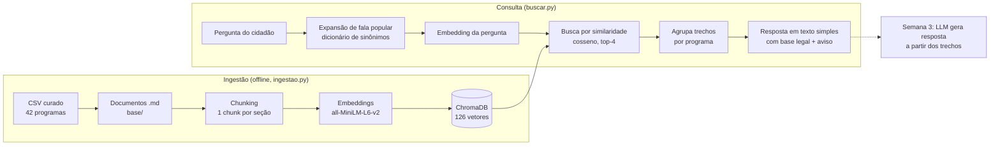

# Base de Conhecimento + Protótipo de Recuperação (G7, Semana 2)

Assistente Virtual Tira-Dúvidas: dada uma pergunta em linguagem popular, recupera os trechos
mais relevantes de uma base curada de programas sociais.

## Como rodar

Todos os comandos rodam **dentro da pasta `rag/`**:

```bash
cd SegundoChallenge/rag
python3 -m venv .venv                     # uma vez só
.venv/bin/pip install -r requirements.txt # uma vez só

.venv/bin/python ingestao.py              # monta a base e o banco vetorial (rodar de novo se o CSV mudar)
.venv/bin/python buscar.py "Estou desempregada e tenho três filhos, tenho direito a algum auxílio?"
.venv/bin/python buscar.py --trechos "..."  # mostra os trechos crus recuperados, com score (demo técnica)
.venv/bin/python avaliar.py               # métricas de recuperação
```

Na primeira execução, o Chroma baixa o modelo de embeddings (~80 MB). Depois disso, tudo roda
offline, sem chave de API e sem custo.

## Arquivos

| Arquivo | O que faz |
|---|---|
| `../programas_sociais_legislacao_links_oficiais.csv` | Planilha curada pelo grupo (fonte da base) |
| `ingestao.py` | Pipeline de ingestão: CSV → documentos → chunks → embeddings → ChromaDB |
| `base/*.md` | Base curada: **42 documentos-fonte**, um por programa (gerados pela ingestão) |
| `chroma_db/` | Banco vetorial persistido em disco |
| `buscar.py` | Protótipo de recuperação (consulta → top-4 trechos) |
| `avaliar.py` | 20 perguntas de teste com o programa esperado |

## Base curada

- **42 documentos**, um por programa social federal da lista do MDS usada pelo CadÚnico (abr/2025).
- Cobrem **18 órgãos** (MDS, MEC, INSS, ANEEL, ANATEL, INCRA, Ministério da Saúde…).
- Cada documento cita sua **legislação oficial**: 30 leis/decretos distintos com link para a
  Câmara dos Deputados / Diário Oficial da União, verificados em 2026.
- Metadados de cada documento: programa, órgão, esfera, categoria, fonte (com página) e URL.

## Arquitetura



### Pipeline de ingestão

1. **Curadoria:** o grupo levantou os programas, os critérios e a legislação vigente na planilha CSV.
2. **Documentos:** `ingestao.py` transforma cada linha num `.md` com cabeçalho de metadados e três
   seções (*O que é*, *Quem pode*, *Legislação*).
3. **Chunking:** cada documento é quebrado nas seções `##`.
4. **Embeddings + indexação:** o Chroma gera os vetores e grava os trechos com seus metadados em
   `chroma_db/`. A coleção é recriada a cada ingestão, então atualizar a base é só editar o CSV e
   rodar de novo (mitigação MR05).

## Estratégia de chunking

- **Por seção semântica**, não por tamanho fixo: cada documento vira 3 chunks (42 × 3 = **126 chunks**).
- Motivo: as perguntas costumam mirar um aspecto ("quem pode?", "qual a lei?"). Um chunk por
  seção devolve exatamente essa parte, e os documentos já são curtos (~100–200 palavras), então
  não há o que cortar.
- Cada chunk começa com **o nome do programa e da seção** (ex.: "Bolsa Família - Quem pode"). Assim,
  o trecho continua compreensível sozinho e o nome do programa entra no embedding.
- Os metadados (programa, órgão, fonte, URL) acompanham cada chunk, para citar a fonte na resposta.

## Estratégia de embeddings e banco vetorial

- **Banco vetorial:** ChromaDB em modo persistente local, com índice HNSW e **distância de cosseno**.
  Instala com `pip` e não precisa de servidor.
- **Embeddings:** modelo padrão do Chroma, `all-MiniLM-L6-v2` (384 dimensões, roda em CPU via ONNX).
  Foi escolhido por ser gratuito, leve e funcionar sem configuração.
- **Expansão de consulta:** como o modelo foi treinado principalmente em inglês, antes da busca a
  pergunta recebe termos oficiais equivalentes à fala popular (ex.: "botijão" → "auxílio gás GLP",
  "roça" → "rural agricultura familiar"). Isso atende ao RIA01.

## Resultados (`avaliar.py`)

A busca pede 16 trechos ao banco e agrupa por programa, para que o mesmo programa não ocupe várias
posições (antes, as 3 seções de um único programa podiam tomar o top-4). A resposta é montada por
um modelo de texto fixo a partir do documento de cada programa, sem LLM.

- **Acerto@4: 19/21 (90%)**: o programa esperado aparece entre os 4 programas retornados.
- Erros: "quero fazer faculdade…" (trouxe Sisu e PNAES, que também são pertinentes, mas não o FIES
  Social) e "cesta de comida… fome" (não trouxe a Ação de Distribuição de Alimentos).

## Limitações e próximos passos

- **Abstenção (RIA07) ainda não é possível só pelo score:** com esse modelo, perguntas fora do
  escopo ("bolo de cenoura") chegam a 0,56 de similaridade, igual ao menor score de perguntas
  válidas. Próximo passo: trocar por um modelo de embeddings **multilíngue** (ex.:
  `paraphrase-multilingual-MiniLM-L12-v2`) e recalibrar com `avaliar.py`.
- A base ainda não tem **documentos exigidos** nem **unidades de atendimento** (RF04/RF05), nem
  programas **distritais** (SEDES-DF, CODHAB, SEEDF, como o Prato Cheio).
- Semana 3: ligar uma LLM aos trechos recuperados e comparar LLM pura × RAG.
