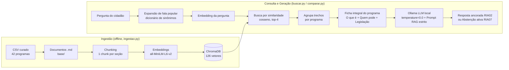

# Base de Conhecimento + Recuperação e Geração RAG (G7, Semanas 2 e 3)

Assistente Virtual Tira-Dúvidas: dada uma pergunta em linguagem popular, recupera os trechos
mais relevantes de uma base curada de programas sociais e gera respostas ancoradas nas evidências
usando uma LLM local via Ollama, comparando **LLM Pura × LLM com RAG**.

## Como rodar

Todos os comandos rodam **dentro da pasta `rag/`**:

```bash
cd SegundoChallenge/rag
python3 -m venv .venv                     # uma vez só
.venv/bin/pip install -r requirements.txt # uma vez só

.venv/bin/python ingestao.py              # monta a base e o banco vetorial (rodar de novo se o CSV mudar)
.venv/bin/python buscar.py "Estou desempregada e tenho três filhos, tenho direito a algum auxílio?"
.venv/bin/python buscar.py --trechos "..."  # mostra os trechos crus recuperados, com score (demo técnica)
.venv/bin/python buscar.py --llm "..."      # gera resposta com LLM local (Ollama) ancorada no RAG
.venv/bin/python avaliar.py               # métricas de recuperação (Recall@4)

# Semana 3: Comparação LLM Pura (sem contexto) × LLM com RAG (ChromaDB)
.venv/bin/python comparar.py "tem ajuda para comprar o botijão de gás?" # compara uma pergunta no terminal
.venv/bin/python comparar.py              # roda a bateria completa e gera relatorio_comparacao.md
.venv/bin/python comparar.py --modelo qwen2.5:3b --limite 4 # escolhe o modelo e limita o nº de casos
```

Na primeira execução, o Chroma baixa o modelo de embeddings (~80 MB). Para os comandos de geração
(`comparar.py` e `buscar.py --llm`), basta ter o [Ollama](https://ollama.com) ativo localmente
(`ollama serve`) com um modelo instalado (ex.: `ollama pull qwen2.5:3b` ou `ollama pull llama3.2:3b`).
Tudo roda 100% offline, sem chave de API e sem custo.

## Arquivos

| Arquivo | O que faz |
|---|---|
| `../programas_sociais_legislacao_links_oficiais.csv` | Planilha curada pelo grupo (fonte da base) |
| `ingestao.py` | Pipeline de ingestão: CSV → documentos → chunks → embeddings → ChromaDB |
| `base/*.md` | Base curada: **42 documentos-fonte**, um por programa (gerados pela ingestão) |
| `chroma_db/` | Banco vetorial persistido em disco |
| `buscar.py` | Protótipo de recuperação e geração (`--trechos` e `--llm`) |
| `avaliar.py` | 21 perguntas de teste com o programa esperado + 4 fora do escopo |
| `comparar.py` | Integração com Ollama (`temperature=0.0`) e comparação **LLM Pura × RAG** |
| `relatorio_comparacao.md` | Relatório comparativo gerado automaticamente por `comparar.py` |

## Base curada

- **42 documentos**, um por programa social federal da lista do MDS usada pelo CadÚnico (abr/2025).
- Cobrem **18 órgãos** (MDS, MEC, INSS, ANEEL, ANATEL, INCRA, Ministério da Saúde…).
- Cada documento cita sua **legislação oficial**: 30 leis/decretos distintos com link para a
  Câmara dos Deputados / Diário Oficial da União, verificados em 2026.
- Metadados de cada documento: programa, órgão, esfera, categoria, fonte (com página) e URL.

## Arquitetura



### Pipeline de ingestão

1. **Curadoria:** o grupo levantou os programas, os critérios e a legislação vigente na planilha CSV.
2. **Documentos:** `ingestao.py` transforma cada linha num `.md` com cabeçalho de metadados e três
   seções (*O que é*, *Quem pode*, *Legislação*).
3. **Chunking:** cada documento é quebrado nas seções `##`.
4. **Embeddings + indexação:** o Chroma gera os vetores e grava os trechos com seus metadados em
   `chroma_db/`. A coleção é recriada a cada ingestão, então atualizar a base é só editar o CSV e
   rodar de novo (mitigação MR05).

## Estratégia de chunking

- **Por seção semântica**, não por tamanho fixo: cada documento vira 3 chunks (42 × 3 = **126 chunks**).
- Motivo: as perguntas costumam mirar um aspecto ("quem pode?", "qual a lei?"). Um chunk por
  seção devolve exatamente essa parte, e os documentos já são curtos (~100–200 palavras), então
  não há o que cortar.
- Cada chunk começa com **o nome do programa e da seção** (ex.: "Bolsa Família - Quem pode"). Assim,
  o trecho continua compreensível sozinho e o nome do programa entra no embedding.
- Os metadados (programa, órgão, fonte, URL) acompanham cada chunk, para citar a fonte na resposta.

## Estratégia de embeddings e banco vetorial

- **Banco vetorial:** ChromaDB em modo persistente local, com índice HNSW e **distância de cosseno**.
  Instala com `pip` e não precisa de servidor.
- **Embeddings:** modelo padrão do Chroma, `all-MiniLM-L6-v2` (384 dimensões, roda em CPU via ONNX).
  Foi escolhido por ser gratuito, leve e funcionar sem configuração.
- **Expansão de consulta:** como o modelo foi treinado principalmente em inglês, antes da busca a
  pergunta recebe termos oficiais equivalentes à fala popular (ex.: "botijão" → "auxílio gás GLP",
  "roça" → "rural agricultura familiar"). Isso atende ao RIA01.

## Resultados (`avaliar.py`)

A busca pede 16 trechos ao banco e agrupa por programa, para que o mesmo programa não ocupe várias
posições (antes, as 3 seções de um único programa podiam tomar o top-4). A resposta é montada por
um modelo de texto fixo a partir do documento de cada programa, sem LLM.

- **Acerto@4: 19/21 (90%)**: o programa esperado aparece entre os 4 programas retornados.
- Erros: "quero fazer faculdade…" (trouxe Sisu e PNAES, que também são pertinentes, mas não o FIES
  Social) e "cesta de comida… fome" (não trouxe a Ação de Distribuição de Alimentos).

## Comparação LLM Pura × RAG (`comparar.py` — Semana 3)

O módulo `comparar.py` conecta a recuperação no ChromaDB a uma LLM local via API HTTP do **Ollama**
(`http://localhost:11434/api/chat`, usando apenas `urllib.request` da biblioteca padrão e
`temperature=0.0` conforme mitigação **MR01**).

Dois modos são executados e avaliados lado a lado:

1. **LLM Pura (`responder_llm_pura`)**: recebe apenas a pergunta e o papel do assistente, respondendo
   com o conhecimento paramétrico do modelo.
2. **LLM com RAG (`responder_rag`)**: recebe os documentos completos dos `TOP_K=4` programas
   recuperados de `base/*.md` e instruções estritas para:
   - **Ancoragem estrita (RIA02)**: usar exclusivamente os dados da base homologada, citando órgão
     responsável, lei base, regulamentação e atualizações normativas de 2024–2026 (ex.: *Gás do Povo*
     pela Lei nº 15.348/2026, *Luz do Povo* pela Lei nº 15.235/2025, biometria do BPC pela Portaria
     Conjunta MDS/INSS nº 36/2026);
   - **Transparência sobre lacunas**: informar quando o documento oficial traz critérios parciais ou
     não especificados, sem inventar regras;
   - **Abstenção ativa e limites institucionais (RIA07 / P02)**: recusar perguntas fora do escopo
     socioassistencial (mesmo que o banco vetorial devolva trechos com score ~0,50) e recusar pedidos
     operacionais proibidos (consultar CPF/CadÚnico, cadastrar ou aprovar benefício).

O resultado detalhado com métricas agregadas e respostas lado a lado é salvo em
`relatorio_comparacao.md`.

## Avaliação com RAGAS (Ollama local)

### Resultados da bateria completa

As médias abaixo usam os 21 casos dentro do escopo, com `qwen2.5:3b` como gerador
e juiz. Os quatro casos fora do escopo são avaliados separadamente.

| Métrica RAGAS | Média | Casos avaliados |
|---|---:|---:|
| Faithfulness | 0.543 | 21 |
| Context Utilization | 0.595 | 21 |
| Context Precision | 0.421 | 21 |
| Context Recall | 0.888 | 21 |

| Indicador próprio do projeto | Resultado | Taxa |
|---|---:|---:|
| Programa esperado recuperado no top-4 | 19/21 | 90,5% |
| Abstenção fora do escopo | 1/4 | 25,0% |
| Falhas técnicas após a retomada | 0/84 notas | 0,0% |

As notas são exploratórias e as referências precisam de revisão humana.
Consulte o [relatório com as tabelas por pergunta](avaliacao/resultados_completos/relatorio.md)
e o [CSV da bateria completa](avaliacao/resultados_completos/metricas.csv).
Os arquivos em `avaliacao/resultados/` correspondem ao teste inicial de duas perguntas.

### Executar a avaliação

O workflow em `avaliar_ragas.py` complementa o acerto@4 de `avaliar.py`.
Execute os comandos dentro de `rag/`, com o Ollama ativo e a base já ingerida:

```bash
.venv/bin/pip install -r requirements-avaliacao.txt
# Se ainda não houver modelo instalado:
ollama pull qwen2.5:3b
.venv/bin/python avaliar_ragas.py preparar

# Primeiro experimente poucos casos; use um modelo instalado no Ollama.
.venv/bin/python avaliar_ragas.py coletar --modelo qwen2.5:3b --limite 2
.venv/bin/python avaliar_ragas.py avaliar --juiz qwen2.5:3b

# Para coletar todos os 25 casos, execute coletar novamente sem --limite.
# Para preservar o teste inicial em arquivos separados:
.venv/bin/python avaliar_ragas.py coletar --modelo qwen2.5:3b --amostras avaliacao/amostras_completas.jsonl
.venv/bin/python avaliar_ragas.py avaliar --juiz qwen2.5:3b --amostras avaliacao/amostras_completas.jsonl --saida avaliacao/resultados_completos
# Se houver falhas ou uma execução interrompida, preserve as notas válidas:
.venv/bin/python avaliar_ragas.py avaliar --juiz qwen2.5:3b --amostras avaliacao/amostras_completas.jsonl --saida avaliacao/resultados_completos --retomar --max-tokens 4096
```

1. **Preparar:** cria `avaliacao/casos.jsonl` a partir das 21 perguntas dentro do
   escopo e das quatro fora do escopo. Não sobrescreve um arquivo existente.
   Opcionalmente preencha `reference` em cada caso dentro do escopo com uma resposta
   esperada revisada pelo grupo, baseada nas fontes oficiais. O nome do programa
   sozinho não é uma referência suficiente. Faça isso antes de coletar.
2. **Coletar:** executa `responder_rag`, salvando resposta, documentos completos na
   ordem da recuperação, modelo, data UTC, duração e acerto de recuperação em
   `avaliacao/amostras.jsonl`. Uma nova coleta sobrescreve esse arquivo.
3. **Avaliar:** usa as amostras salvas e um juiz explícito no Ollama; não gera novas
   respostas. Salva `resultados.jsonl`, `metricas.csv` e `resumo.json` em
   `avaliacao/resultados/`. Uma nova avaliação sobrescreve esses relatórios.

Usamos os nomes das métricas do RAGAS, preservando seus identificadores nos relatórios:

| Métrica RAGAS | Identificador no relatório | O que avalia |
|---|---|---|
| Faithfulness | `faithfulness` | Sustentação das afirmações pelos contextos |
| Context Utilization | `context_utilization` | Relevância dos contextos em relação à resposta gerada, sem referência |
| Context Precision | `context_precision` | Ordenação dos contextos relevantes em relação à referência |
| Context Recall | `context_recall` | Cobertura das afirmações da referência pelos contextos |

Os campos de avaliação também seguem a nomenclatura RAGAS: `user_input` (pergunta),
`response` (resposta gerada), `retrieved_contexts` (lista ordenada de contextos) e
`reference` (resposta esperada revisada). `reference` não é o nome do programa
esperado nem uma lista de documentos.

As 21 referências iniciais foram redigidas a partir dos documentos locais de
`base/`, independentemente das respostas do modelo. Os metadados próprios
`reference_source`, `reference_source_sha256` e `reference_status` registram a
origem, a versão do documento e a ausência de validação externa. Elas avaliam
aderência à base local; ainda precisam de revisão humana para servir como
referências de correção factual e atualidade normativa. Não preencha `reference`
com a resposta que o próprio RAG gerou.
Cada referência cobre o programa esperado do teste. Perguntas amplas podem admitir
outros programas válidos; resultados baixos nesses casos precisam de revisão,
pois a referência não é necessariamente uma lista exaustiva de respostas válidas.

Context Precision e Context Recall ficam vazias quando `reference` não foi
preenchida. Answer Relevancy não está incluída nesta primeira
versão, pois requer configurar também embeddings para o avaliador.

As médias incluem apenas notas válidas e informam o número de avaliações e falhas.
Falhas ficam registradas por pergunta e resultam em código de saída diferente de
zero; não viram nota zero. Casos fora do escopo não entram nas médias RAGAS:
registramos `abstencao_heuristica`, usando o detector textual existente, que deve
ser conferido manualmente. A duração registrada é a retornada pelo pipeline,
não inclui o tempo de avaliação do juiz.

Você pode mudar caminhos com `--casos`, `--amostras` e `--saida`, e o servidor com
`--url http://localhost:11434`. Para comparar juízes sobre as mesmas respostas,
execute `avaliar` novamente com outro `--juiz` e outro `--saida`.
`--retomar` exige as mesmas amostras e o mesmo juiz, reutiliza notas válidas e
repete somente métricas ausentes ou com falha. O limite da saída do juiz é
configurável com `--max-tokens` (padrão: 4096); `max_tokens_por_metrica` registra o
limite nas novas avaliações. Notas antigas sem esse metadado não têm o limite
registrado. Um limite maior evita saídas JSON truncadas em respostas extensas.
Prefira um juiz diferente ou mais capaz que o gerador e revise uma amostra das
notas em português. Modelos pequenos podem falhar na produção do JSON estruturado
exigido pelo RAGAS. Uma nota alta de Faithfulness não comprova a atualidade da base.
`acerto_top_k` e `abstencao_heuristica` são indicadores próprios do projeto,
separados das métricas RAGAS.

Referências: [Faithfulness](https://docs.ragas.io/en/latest/concepts/metrics/available_metrics/faithfulness/),
[Context Precision e Context Utilization](https://docs.ragas.io/en/latest/concepts/metrics/available_metrics/context_precision/),
[Context Recall](https://docs.ragas.io/en/latest/concepts/metrics/available_metrics/context_recall/).

## Limitações do protótipo

- A classificação de escopo e a validação de evidências usam o gerador local e podem errar.
  O pipeline faz até duas chamadas adicionais antes da geração. JSON inválido interrompe
  a resposta com uma mensagem de falha de validação. Não há limiar arbitrário de similaridade.
- A base ainda não tem **documentos exigidos** nem **unidades de atendimento** (RF04/RF05), nem
  programas **distritais** (SEDES-DF, CODHAB, SEEDF, como o Prato Cheio).

## Resultados da abstenção — v2

Nova coleta no Ollama com `qwen2.5:3b`, usando as mesmas 25 perguntas da bateria
histórica, após adicionar classificação de escopo e validação das evidências.

| Indicador próprio do projeto | Resultado v2 | Taxa |
|---|---:|---:|
| Abstenção em perguntas fora do escopo | 4/4 | 100,0% |
| Não respostas em perguntas dentro do escopo | 21/21 | 100,0% |

A abstenção fora do escopo passou de 1/4 para 4/4, mas o sistema também deixou de
responder a todas as 21 perguntas válidas. Foram 20 decisões `sem_evidencia` e
uma classificação incorreta como `fora_do_escopo` entre essas perguntas.
**A v2 apresentou regressão por excesso de abstenção e ainda precisa de ajuste.**
Os nove testes de fluxo passaram, mas não comprovam a qualidade das decisões do modelo.

Estas contagens são indicadores do pipeline. As métricas RAGAS não foram
recalculadas para a v2; as notas da bateria histórica acima permanecem separadas.

- [Relatório v2 com os motivos por pergunta](avaliacao/relatorio_abstencao_v2.md)
- [Resumo v2 em JSON](avaliacao/resumo_abstencao_v2.json)
- [Respostas e decisões da v2](avaliacao/amostras_abstencao_v2.jsonl)

## Abstenção estruturada

`responder_rag(..., decisao=dicionario)` mantém o retorno de três itens e preenche
`status`, `motivo` e `absteve`. As decisões distinguem `respondida`, `fora_do_escopo`,
`limite_operacional`, `ambigua`, `sem_evidencia` e `falha_validacao`.
A classificação precede a busca; só documentos aprovados pela checagem de evidências
são enviados ao gerador. Os programas retornados continuam representando a busca
completa, para permitir auditoria e medir recuperação.

Novas coletas registram a decisão, `abstencao_fora_escopo` e `abstencao_indevida`.
O segundo indicador conta qualquer não resposta em casos rotulados dentro do escopo,
inclusive falhas de validação e falta de evidências; revise os motivos antes de
concluir que todas são recusas erradas. `abstencao_heuristica` fica como indicador
textual auxiliar. As durações agora incluem classificação, busca, validação e geração.

Os relatórios históricos não foram recalculados. Para avaliar o novo comportamento,
execute a partir de `rag/`, usando novos arquivos:

```bash
.venv/bin/python avaliar_ragas.py preparar --casos avaliacao/casos_abstencao.jsonl
# Revise as referências e os rótulos dos novos casos antes da avaliação.
.venv/bin/python avaliar_ragas.py coletar --casos avaliacao/casos_abstencao.jsonl --amostras avaliacao/amostras_abstencao.jsonl --modelo qwen2.5:3b
.venv/bin/python avaliar_ragas.py avaliar --amostras avaliacao/amostras_abstencao.jsonl --saida avaliacao/resultados_abstencao --juiz qwen2.5:3b
```

Prefira um juiz diferente do gerador quando disponível. Para comparar a mesma bateria
histórica, use `--casos avaliacao/casos.jsonl` na coleta, com novos caminhos de saída.
Testes do fluxo sem serviços externos: `.venv/bin/python -m unittest discover -s tests -v`.
