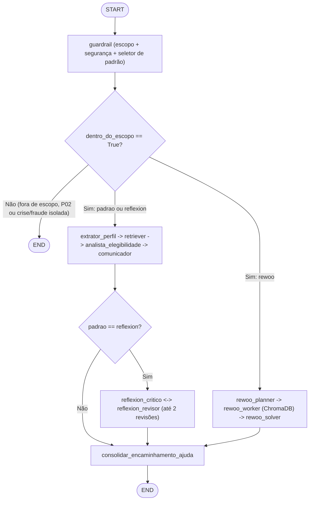

> Integração local: o chat agora chama `POST /api/orientar`, que executa este grafo.
> Veja [a ligação HTTP e seus limites](../Back-end/INTEGRACAO.md).
> Testes do pacote: `python -m unittest discover -s sistema_multiagente -p "test_*.py"` ou `python -m unittest sistema_multiagente.test_guardrail_ajuda sistema_multiagente.test_resiliencia_fallback`.
> CLI: `python -m sistema_multiagente.main "sua pergunta"`.

# Sistema Multiagente — Assistente Socioassistencial (LangGraph + Gemini + RAG)

Assistente virtual **exclusivamente informativo** sobre programas e benefícios sociais federais do Brasil, implementado com arquitetura multiagente em **LangGraph**, modelos **Google Gemini** escalonados por complexidade cognitiva e recuperação documental (**RAG**) ancorada nos **42 programas oficiais** catalogados em `Dados-RAG/programas_sociais_legislacao_links_oficiais.csv`.

> **Importante (Premissa P02):** este sistema **não realiza cadastro**, **não consulta CPF nem o CadÚnico**, **não verifica aprovação individual** e **não substitui** o atendimento presencial do CRAS, CREAS ou do órgão gestor.

---

## Sumário

1. [Arquitetura e Padrões de Execução](#arquitetura-e-padrões-de-execução)
2. [Acolhimento de Segurança e Resposta Dupla](#acolhimento-de-segurança-e-resposta-dupla)
3. [Tiers de Modelos Gemini e Arquitetura de Resiliência (4 Camadas)](#tiers-de-modelos-gemini-e-arquitetura-de-resiliência-4-camadas)
4. [Estrutura de Arquivos](#estrutura-de-arquivos)
5. [Como Executar do Zero](#como-executar-do-zero)
6. [Exemplos de Execução no CLI](#exemplos-de-execução-no-cli)
7. [Uso Programático em Python](#uso-programático-em-python)
8. [Testes Automatizados](#testes-automatizados)
9. [Privacidade (LGPD) e Solução de Problemas](#privacidade-lgpd-e-solução-de-problemas)

---

## Arquitetura e Padrões de Execução

O grafo LangGraph inicia sempre no nó **`guardrail`**, que valida o escopo socioassistencial, detecta sinais que exijam mensagem adicional de apoio/proteção e escolhe dinamicamente o padrão de execução mais adequado ao relato do cidadão:



### Os 3 padrões agênticos

- **`padrao`** *(relatos simples ou dúvida direta sobre um único tema)*:
  `extrator_perfil` → `retriever` (ChromaDB) → `analista_elegibilidade` (ancoragem estrita RIA02) → `comunicador` (linguagem simples + próximos passos práticos + aviso P02).
- **`rewoo`** *(Reasoning Without Observation — relatos multifacetados com 3+ vulnerabilidades ou perguntas amplas/comparativas)*:
  `rewoo_planner` (extrai perfil e decompõe em subconsultas `#E1..#En`) → `rewoo_worker` (executa as buscas em lote no ChromaDB sem chamar LLM) → `rewoo_solver` (analisa todas as evidências consolidadas e redige a orientação integrada).
- **`reflexion`** *(casos limítrofes, acumulação de benefícios como BPC + Bolsa Família ou exigência explícita de detalhamento legal/normativo 2024–2026)*:
  Executa o pipeline base seguido de auditoria crítica (`reflexion_critico` ↔ `reflexion_revisor`, até `MAX_ITERACOES_REFLEXION = 2`) para verificar ancoragem documental (RIA02), nomes oficiais, leis/portarias e ausência de alucinações.

---

## Acolhimento de Segurança e Resposta Dupla

O nó `guardrail` combina **regras determinísticas de alta precisão**, **classificação estruturada via LLM** e **fallback contra filtros `SAFETY`** para tratar situações sensíveis sem aplicar bloqueio punitivo:

| Situação identificada | Comportamento do pipeline | `status_api` |
| --- | --- | --- |
| **Vulnerabilidade/dúvida de benefício + Autoextermínio e/ou Código Penal** *(ex.: mãe solo desempregada expressando ideação suicida ou vítima de violência doméstica buscando auxílio)* | Executa integralmente o fluxo de benefícios (`padrao`/`rewoo`/`reflexion`) **e** anexa a mensagem adicional de apoio/proteção com canais oficiais | `sucesso_com_encaminhamento_ajuda` |
| **Autoextermínio ou matéria penal isolada (sem contexto socioeconômico) ou pedido explícito de fraude/ilícito** | Encerra no `guardrail` sem acionar busca de benefícios nem apoiar ilícitos, exibindo os canais oficiais de ajuda/proteção | `encaminhamento_ajuda` |
| **Relato socioeconômico legítimo** *(inclusive metáforas coloquiais como "a conta de luz está me matando" ou "cortaram meu Bolsa Família")* | Executa normalmente o padrão selecionado (`mensagem_apoio = None`) | `sucesso` |
| **Assunto fora de escopo** *(receitas, futebol)* ou **operação proibida P02 pura** *(consultar CPF/CadÚnico)* | Encerra no `guardrail` com orientação institucional padrão | `bloqueado_guardrail` |
| **Indisponibilidade de LLM com contingência determinística ou preservação de rascunho** *(ex.: queda de Gemini em relato socioeconômico válido ou falha no ciclo opcional `reflexion`)* | Preserva rascunho validado ou entrega fichas oficiais diretamente via RAG local (sem alucinar elegibilidade) com `AVISO_INSTITUCIONAL` | `sucesso_degradado` ou `sucesso_degradado_com_encaminhamento_ajuda` |
| **Falha técnica sem contingência segura possível** *(ex.: fora de escopo sob queda total de LLMs ou falha simultânea de LLM + RAG)* | Comportamento *fail-closed* (preservando a mensagem de apoio caso um sinal crítico já tenha sido identificado) | `erro_api` |

**Canais públicos oficiais indicados na mensagem adicional de apoio:**
- **Autoextermínio / autolesão:** CVV (**Ligue 188** e `https://cvv.org.br`, 24h gratuito e sigiloso), SAMU (**192**), Corpo de Bombeiros (**193**), CAPS / UPA 24h / UBS pelo **SUS** e **CRAS / CREAS**.
- **Elementos do Código Penal (violência, ameaça, abuso, crimes ou ilícitos):** Polícia Militar (**190**), Polícia Civil / Delegacia (**197**), Central de Atendimento à Mulher (**Ligue 180**), Disque Direitos Humanos (**Disque 100**), Disque-Denúncia (**181**), **CREAS / CRAS** e Defensoria Pública (**Ligue 129**).

---

## Tiers de Modelos Gemini e Arquitetura de Resiliência (4 Camadas)

Definidos centralmente em [`config.py`](config.py) e [`llm_providers.py`](llm_providers.py) com temperatura `0.0`:

| Tier | Modelo Principal | Fallbacks | Agentes atendidos |
| --- | --- | --- | --- |
| `rapido` | `gemini-3.1-flash-lite` | `gemini-3.5-flash-lite`, `gemini-4-hydrogen` | `guardrail`, `extrator_perfil` |
| `equilibrado` | `gemini-3.5-flash-lite` | `gemini-3.1-flash-lite`, `gemini-4-hydrogen` | `comunicador`, `rewoo_planner`, `rewoo_comunicador`, `reflexion_revisor` |
| `analitico` | `gemini-4-hydrogen` | `gemini-3.5-flash-lite`, `gemini-3.1-flash-lite` | `analista_elegibilidade`, `rewoo_solver`, `reflexion_critico` |

Para resistir a alta demanda (`429`, `503`, timeouts e instabilidade de rede) sem quebrar o atendimento, o pipeline opera em **4 camadas progressivas**:

1. **Camada 1 — Endurecimento Gemini (`config.py`):** retry explícito via `tenacity` com backoff exponencial + jitter apenas em erros transitórios, taxonomia tipada de erros, overrides de modelos/timeouts por ambiente e **circuit breaker com cooldown/TTL** (`429`/`503` entram em cooldown temporário em vez de banimento definitivo; `404` fica em quarentena na sessão; `401`/`403` abre circuito do provedor).
2. **Camada 2 — Provedor secundário opt-in (`llm_providers.py`, sem novas dependências):** acionada somente quando configurada via `LLM_FALLBACK_ORDER`.
   - **Ollama local (recomendado para LGPD / RNF05):** `LLM_FALLBACK_ORDER=ollama`, `OLLAMA_URL=http://127.0.0.1:11434`, `OLLAMA_LLM_MODEL=qwen2.5:7b` (usa `/api/chat` com saída JSON estruturada nativa e simplifica `rewoo`/`reflexion` para `padrao` para preservar estabilidade e latência).
   - **OpenAI-compatible (opt-in explícito):** `LLM_FALLBACK_ORDER=openai_compat`, `LLM_FALLBACK_BASE_URL`, `LLM_FALLBACK_API_KEY`, `LLM_FALLBACK_MODEL`. *Atenção LGPD:* desativado por padrão — avalie a política de retenção zero do provedor escolhido antes de habilitar para relatos sensíveis.
3. **Camada 3 — Degradação graciosa no grafo (`agents.py` / `graph.py`):** falha no `reflexion_critico`/`reflexion_revisor` preserva o rascunho validado do `comunicador`; falha no `rewoo_planner` faz downgrade limpo para `padrao`; falha na síntese do `rewoo_solver` ou `comunicador` formata de modo determinístico o parecer `AnaliseElegibilidade` já produzido.
4. **Camada 4 — Fallback determinístico ancorado no RAG (`rag.py`):** em indisponibilidade total de LLMs para relatos socioeconômicos válidos (sem violação P02 e sem fraude/ilícito), entrega diretamente as fichas oficiais recuperadas do ChromaDB local com aviso transparente de modo informativo simplificado, próximos passos no CRAS, `AVISO_INSTITUCIONAL` e resposta dupla preservada (mensagens fora de escopo continuam *fail-closed*).

---

## Estrutura de Arquivos

| Arquivo | Responsabilidade |
| --- | --- |
| [`main.py`](main.py) | Ponto de entrada CLI (execução direta, modo interativo, flag `--debug` com eventos de fallback/degradação e exibição separada de benefícios + apoio). |
| [`graph.py`](graph.py) | Construção e compilação do `StateGraph` no LangGraph, roteadores condicionais de degradação/downgrade, `estado_inicial()` e `executar_fluxo()`. |
| [`agents.py`](agents.py) | Prompts e implementação de todos os agentes (`guardrail`, `extrator_perfil`, `retriever`, `analista_elegibilidade`, `comunicador`, `rewoo_*`, `reflexion_*`, `fallback_rag` e `consolidar_encaminhamento_ajuda`). |
| [`schemas.py`](schemas.py) | `EstadoSistema`, constantes de `status_api` (incluindo status degradados) e modelos Pydantic de saída estruturada. |
| [`rag.py`](rag.py) | Integração com a base oficial em `Dados-RAG/` (ChromaDB local automático ou `KnowledgeBase`), síntese determinística ancorada (`compor_resposta_deterministica_rag`), busca em lote ReWOO e detectores determinísticos (P02, segurança, fraude, metáforas e contexto socioeconômico). |
| [`config.py`](config.py) | Carregamento lazy de credenciais, cache de clientes Gemini, retry `tenacity`, circuit breaker com TTL e orquestração multi-provedor (`invocar_estruturado` / `invocar_texto`). |
| [`llm_providers.py`](llm_providers.py) | Adaptadores HTTP leves via `httpx` para provedores secundários opt-in (**Ollama local** e **OpenAI-compatible**) e sanitização de mensagens de erro. |
| [`test_guardrail_ajuda.py`](test_guardrail_ajuda.py) | Suíte de testes unitários de segurança, Guardrail, P02 e resposta dupla (offline). |
| [`test_resiliencia_fallback.py`](test_resiliencia_fallback.py) | Suíte de testes unitários das 4 camadas de resiliência, retry, circuit breaker, provedores secundários e degradação graciosa (offline). |
| `.env` *(não versionado)* | Arquivo local contendo `GOOGLE_API_KEY` e variáveis opcionais de fallback (ignorado pelo `.gitignore`). |

---

## Como Executar do Zero

### 1. Pré-requisitos

- **Python 3.12 ou superior** instalado;
- **Git** instalado;
- Uma chave válida da API do Google Gemini (**`GOOGLE_API_KEY`**), obtida no [Google AI Studio](https://aistudio.google.com/apikey).
- *(Opcional)* **Ollama** com o modelo `bge-m3` e índice `Dados-RAG` já ingerido. **Não é obrigatório:** se o Ollama ou o índice externo não estiverem disponíveis, o módulo `rag.py` cria e indexa automaticamente uma coleção local do ChromaDB em `Dados-RAG/RAG/chroma_db/` usando o CSV oficial de `Dados-RAG/` logo na primeira consulta.

### 2. Clonar o repositório

```bash
git clone https://github.com/purpleaither/SegundoChallenge.git
cd SegundoChallenge
```

*(Todos os comandos abaixo assumem que você está na **raiz do repositório** `SegundoChallenge/`.)*

### 3. Criar e ativar o ambiente virtual (`.venv`)

**macOS / Linux (zsh/bash):**

```bash
python3 -m venv .venv
source .venv/bin/activate
```

**Windows (PowerShell):**

```powershell
py -3.12 -m venv .venv
.\.venv\Scripts\Activate.ps1
```

### 4. Instalar as dependências

Com o ambiente virtual ativo:

```bash
python -m pip install --upgrade pip
python -m pip install langgraph langchain-core langchain-google-genai pydantic python-dotenv chromadb
```

### 5. Configurar a variável `GOOGLE_API_KEY`

Crie o arquivo `sistema_multiagente/.env` (este arquivo já está listado no `.gitignore` e nunca deve ser commitado):

**macOS / Linux:**

```bash
cat <<'EOF' > sistema_multiagente/.env
GOOGLE_API_KEY=COLE_SUA_CHAVE_GEMINI_AQUI
EOF
```

**Windows (PowerShell):**

```powershell
Set-Content -Path .\sistema_multiagente\.env -Value "GOOGLE_API_KEY=COLE_SUA_CHAVE_GEMINI_AQUI"
```

*(Alternativamente, você também pode exportar `GOOGLE_API_KEY` diretamente como variável de ambiente no terminal.)*

**Variáveis de ambiente opcionais de resiliência e fallback:**

```bash
# Exemplo opcional — ativar Ollama local como fallback secundário (privacidade total / LGPD):
# ollama pull qwen2.5:7b
LLM_FALLBACK_ORDER=ollama
OLLAMA_URL=http://127.0.0.1:11434
OLLAMA_LLM_MODEL=qwen2.5:7b

# Ajustes finos opcionais de retry/cooldown/modelos Gemini:
# LLM_MAX_TENTATIVAS=2
# LLM_COOLDOWN_SEGUNDOS=60
# GEMINI_MODELO_RAPIDO=gemini-3.1-flash-lite
# GEMINI_FALLBACKS_RAPIDO=gemini-3.5-flash-lite,gemini-4-hydrogen

# Exemplo opcional — provedor cloud OpenAI-compatible (opt-in consciente quanto à LGPD):
# LLM_FALLBACK_ORDER=ollama,openai_compat
# LLM_FALLBACK_BASE_URL=https://api.exemplo.com/v1
# LLM_FALLBACK_API_KEY=SUA_CHAVE_OPCIONAL
# LLM_FALLBACK_MODEL=nome-do-modelo
```

### 6. Executar o sistema

**Execução passando a pergunta diretamente (macOS / Linux):**

```bash
./.venv/bin/python sistema_multiagente/main.py "Estou desempregada, tenho 3 filhos pequenos e não consigo pagar a conta de luz"
```

**Execução passando a pergunta diretamente (Windows PowerShell):**

```powershell
.\.venv\Scripts\python.exe .\sistema_multiagente\main.py "Estou desempregada, tenho 3 filhos pequenos e não consigo pagar a conta de luz"
```

**Modo interativo (o programa pede a frase no terminal):**

```bash
./.venv/bin/python sistema_multiagente/main.py
```

**Modo `--debug` (recomendado para inspeção técnica):**
Exibe o padrão escolhido, modelos escalados por agente, perfil extraído, programas recuperados do ChromaDB com score de similaridade, parecer de elegibilidade e auditorias do Reflexion:

```bash
./.venv/bin/python sistema_multiagente/main.py --debug "Estou desempregada e tenho 3 filhos pequenos, quais auxílios posso pedir?"
```

> **Primeira execução:** ao consultar a base vetorial local pela primeira vez sem Ollama, o ChromaDB pode baixar o modelo de embedding padrão localmente e indexar os 42 programas oficiais em `Dados-RAG/RAG/chroma_db/`. A partir da segunda execução, a busca é imediata.

---

## Exemplos de Execução no CLI

Abaixo estão exemplos práticos para testar cada caminho do grafo com `--debug`:

1. **Padrão `padrao` (dúvida direta / relato simples):**
   ```bash
   ./.venv/bin/python sistema_multiagente/main.py --debug "A conta de luz está me matando, ganho pouco e moro sozinha. Tenho direito a desconto?"
   ```

2. **Padrão `rewoo` (relato multifacetado com 3+ frentes):**
   ```bash
   ./.venv/bin/python sistema_multiagente/main.py --debug "Moro na roça sem água por causa da seca, tenho 2 filhos no ensino médio, minha mãe idosa sem renda mora comigo e o botijão de gás está muito caro"
   ```

3. **Padrão `reflexion` (acumulação de benefícios / exigência normativa):**
   ```bash
   ./.venv/bin/python sistema_multiagente/main.py --debug "Posso acumular BPC com Bolsa Família? Quais leis e portarias de 2024 a 2026 tratam disso?"
   ```

4. **Resposta dupla — vulnerabilidade + autoextermínio (exibe Benefícios + Mensagem Adicional de Apoio):**
   ```bash
   ./.venv/bin/python sistema_multiagente/main.py --debug "sou mae solteira tenho 3 filhos, desempregada, nao aguento mais quero morrer"
   ```

5. **Resposta dupla — vulnerabilidade + Código Penal (exibe Benefícios + Canais de Proteção):**
   ```bash
   ./.venv/bin/python sistema_multiagente/main.py --debug "Meu marido me bate, saí de casa com meus 2 filhos desempregada e sem renda, quais benefícios posso pedir?"
   ```

6. **Bloqueio operacional P02 (consulta de CPF) e fora de escopo:**
   ```bash
   ./.venv/bin/python sistema_multiagente/main.py --debug "Meu CPF é 123.456.789-00, consulta aí no CadÚnico se meu Bolsa Família foi aprovado"
   ./.venv/bin/python sistema_multiagente/main.py --debug "Me passa uma receita de bolo de cenoura"
   ```

---

## Uso Programático em Python

Se quiser integrar o pipeline diretamente em outro script ou API Python:

```python
import sys
from pathlib import Path

sys.path.insert(0, str(Path("sistema_multiagente").resolve()))
from graph import executar_fluxo

estado = executar_fluxo("Estou desempregada e tenho 2 filhos pequenos, quais auxílios existem?")

print("Status:", estado["status_api"])
print("Padrão:", estado["padrao_execucao"])
print("Resposta consolidada:\n", estado["resposta_final"])

# Em casos de resposta dupla (benefícios + apoio), também é possível acessar separadamente:
if estado["resposta_beneficios"] and estado["mensagem_apoio"]:
    print("Benefícios:", estado["resposta_beneficios"])
    print("Apoio oficial:", estado["mensagem_apoio"])
```

---

## Testes Automatizados

Os testes unitários do `sistema_multiagente` usam `unittest.mock` e **não consomem créditos da API Gemini nem precisam de acesso à internet**.

**Executar a suíte do sistema multiagente (macOS / Linux):**

```bash
./.venv/bin/python -m unittest discover -s sistema_multiagente -p "test_*.py" -v
```

**Windows (PowerShell):**

```powershell
.\.venv\Scripts\python.exe -m unittest discover -s sistema_multiagente -p "test_*.py" -v
```

**Executar também os testes unitários da base `Dados-RAG`:**

```bash
./.venv/bin/python -m unittest discover -s Dados-RAG/RAG/testes-automatizados -p "test_*.py" -v
```

---

## Privacidade (LGPD) e Solução de Problemas

### Privacidade (RNF05)
- O pipeline é **stateless**: mensagens e relatos sensíveis do cidadão são mantidos **apenas em memória RAM** durante a execução da requisição e **nunca são gravados em disco, bancos de dados ou arquivos de log**.
- Nunca compartilhe CPF ou documentos pessoais nas consultas.

### Problemas Comuns

- **`GOOGLE_API_KEY` ausente no `.env`**
  O módulo `config.py` não falha mais na importação: se `LLM_FALLBACK_ORDER=ollama` estiver configurado, o sistema usa o Ollama local; sem nenhum provedor LLM disponível, relatos socioeconômicos válidos entram em modo degradado ancorado no RAG local (`sucesso_degradado`).
- **`Status da API: sucesso_degradado` ou `erro_api`**
  Em picos de alta demanda (`429`, `503`, timeouts), o sistema aplica retry com backoff exponencial + jitter, cooldown por TTL, failover para provedor secundário configurado e degradação graciosa ancorada nas fichas oficiais. Mensagens fora de escopo sem LLM permanecem *fail-closed* (`erro_api`).
- **`ModuleNotFoundError` ao rodar `main.py`**
  Certifique-se de executar com o Python do ambiente virtual (`./.venv/bin/python` ou `.\.venv\Scripts\python.exe`) após instalar as dependências do [Passo 4](#4-instalar-as-dependências).
- **Ollama não instalado ou parado**
  Não impede a execução: o `rag.py` alterna automaticamente para a coleção local em `Dados-RAG/RAG/chroma_db/`, e o fallback LLM local falha rapidamente (timeout de conexão curto) sem travar o pipeline.
